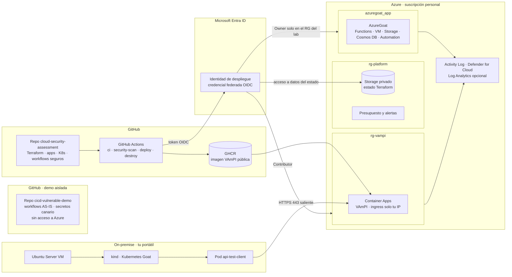

# Cloud Security Assessment

**White-Box Pentesting & CI/CD Security sobre una arquitectura híbrida Azure + on-premise**

> **Aviso:** laboratorio deliberadamente vulnerable, desplegado en una suscripción propia y aislada con fines formativos. No usar credenciales reales ni desplegar estos recursos en entornos corporativos o de producción.

## Objetivo

Diseñar, desplegar y securizar una infraestructura cloud basada en Azure con una parte on-premise (servidor Kubernetes), demostrando el ciclo completo de mejora de seguridad: **vulnerabilidad → control → validación**.

La evaluación sigue una metodología de **caja blanca**: se analiza la arquitectura completa (repositorio, pipeline de CI/CD, infraestructura como código, identidades, configuración cloud, Kubernetes y aplicaciones) y cada hallazgo se demuestra con una prueba de concepto controlada.

## Escenario: NubloPost, S.L.

NubloPost es una startup ficticia (~35 empleados, en fase de crecimiento tras una Serie A) con una plataforma de publicación de contenidos para creadores independientes: perfiles, posts con imágenes (incluida la subida de imagen "desde URL" para importar contenido de otras plataformas), búsqueda de creadores y un catálogo de publicaciones accesible por API.

No tiene equipo de seguridad: la infraestructura la mantiene un equipo de 4 desarrolladores full-stack con perfil DevOps. Es el arquetipo de empresa que pospone la seguridad para priorizar la velocidad de desarrollo, el contexto en el que aparecen este tipo de vulnerabilidades en el mundo real.

La plataforma es híbrida: la aplicación y la API están en Azure, y el equipo DevOps mantiene un pequeño servidor on-premise con Kubernetes para servicios internos que consumen la API cloud. El código y los despliegues se gestionan desde GitHub.

La Function App pública cumple el papel que en un entorno Active Directory clásico tendría el controlador de dominio expuesto: es la superficie perimetral por la que empieza cualquier ataque.

### Niveles de cuenta

| `authLevel` (valor real) | Rol en el escenario |
|---|---|
| `300` | Usuario free (valor por defecto al registrarse) |
| `200` | Usuario pro |
| `100` | Moderador |
| `0` | Administrador de plataforma |

## Arquitectura



| Bloque | Componentes |
|---|---|
| On-premise | VM Ubuntu Server 24.04 (VirtualBox) configurada con Ansible, Docker, kind, Kubernetes Goat y el pod `api-test-client` |
| Azure | AzureGoat (Function Apps, Storage, Cosmos DB, VM, Automation, identidades y RBAC), VAmPI en Container Apps, estado de Terraform y monitorización |
| DevSecOps | GitHub, GitHub Actions con OIDC, Terraform y escáneres de seguridad |

**Repositorios**

- `cloud-security-assessment` (este repositorio): infraestructura, aplicaciones, workflows seguros y documentación.
- `cicd-vulnerable-demo`: escenarios inseguros de GitHub Actions con secretos canario, sin ningún acceso a Azure.

## Activos

| Activo | Descripción |
|---|---|
| Function Apps | Frontend y API serverless de posts, perfiles y autenticación |
| Cosmos DB | Usuarios, posts, contraseñas (bcrypt), preguntas de recuperación y metadatos de cuenta |
| Storage Account | Una cuenta con contenedores `prod` (imágenes y web), `dev` (pruebas, nunca debería exponer datos) y `vm` |
| VM de mantenimiento | Máquina Linux para tareas puntuales del equipo DevOps; identidad gestionada con rol Contributor |
| Cuenta de Azure Automation | Tareas programadas de mantenimiento; identidad gestionada con rol Owner sobre el resource group |
| API de catálogo (VAmPI) | API REST en Container Apps que consumen los servicios internos |
| Servidor on-premise | Kubernetes con servicios internos y el cliente de la API |
| Repositorio y pipeline CI/CD | Código, Terraform, workflows e identidad de despliegue (OIDC) |

## Usuarios y actores

- **Usuario final (free/pro):** crea su perfil, publica contenido y sube imágenes.
- **Administrador de plataforma:** gestiona usuarios y modera contenido.
- **Equipo DevOps:** acceso a la VM de mantenimiento, Azure Automation, Storage, servidor on-premise y GitHub.
- **Auditor (este proyecto):** caja blanca, con acceso de lectura al repositorio y una identidad Reader sobre el laboratorio.

## Datos sensibles

- Credenciales de usuario (email y contraseña con bcrypt) y preguntas/respuestas de recuperación de cuenta.
- Contenido de los posts, incluidos borradores y contenido no publicado.
- Nivel de cuenta (`authLevel`), determinante para el control de acceso.
- Connection strings y secretos (Cosmos DB, Storage, JWT): deberían estar en Key Vault, no en el código ni en ficheros desplegados.
- Credenciales de la API que usan los servicios on-premise.
- Código fuente propietario.

## Requisitos de seguridad

- **Disponibilidad:** la plataforma debe seguir operativa; no se permite DoS durante las pruebas.
- **Confidencialidad** de los datos de usuario y del contenido no publicado.
- **Integridad de los niveles de cuenta:** un usuario free no debe poder autopromocionarse.
- **Separación real** entre los entornos de desarrollo y producción.
- **Mínimo privilegio** en identidades gestionadas, roles RBAC, workflows de CI/CD y Service Accounts de Kubernetes.
- **Secretos fuera** del código, de los ficheros desplegados y de los logs del pipeline.

## Modelo de amenazas

- **Atacante oportunista externo:** recorre la superficie pública buscando vulnerabilidades comunes (OWASP Top 10 y OWASP API Security Top 10).
- **Atacante orientado a la exfiltración:** busca datos de usuarios o código fuente con valor competitivo o reputacional.
- **Escalada en la nube:** el riesgo diferencial frente a un Active Directory clásico. Un punto de apoyo inicial (por ejemplo, una clave SSH filtrada) puede escalar a control total del resource group mediante identidades gestionadas mal configuradas, sin movimiento lateral de red tradicional.
- **Confused deputy en Azure Automation:** una identidad con pocos privilegios ejecuta código, de forma indirecta, con los privilegios de otra más potente.
- **Cadena de suministro:** secretos en el repositorio, workflows con permisos excesivos o acciones sin fijar comprometen el despliegue.
- **Pivote on-premise → cloud:** el compromiso del clúster local expone credenciales que dan acceso a servicios en Azure.

## Objetivos de la evaluación

- Determinar si un atacante puede comprometer cuentas de usuario o de administrador.
- Evaluar si la subida de contenido (imagen desde URL) expone el backend a SSRF u otras fugas de información.
- Verificar la segregación real entre los entornos dev y prod.
- Determinar la profundidad máxima de escalada de privilegios desde un punto de apoyo de bajo privilegio.
- Evaluar la seguridad del repositorio, del pipeline de CI/CD y del clúster Kubernetes.
- Medir qué detectan las herramientas automáticas y qué requiere revisión manual (matriz de cobertura).
- Producir evidencias y recomendaciones de mitigación accionables para cada hallazgo.

## Alcance

| Dentro del alcance | Fuera del alcance |
|---|---|
| Recursos Azure del laboratorio (`azuregoat_app`, `rg-vampi`, `rg-platform`) | Infraestructura de terceros o corporativa |
| Servidor on-premise y clúster Kubernetes local | Ataques contra la infraestructura de GitHub o de Microsoft |
| Repositorios GitHub del proyecto y sus workflows | Denegación de servicio y pruebas destructivas |
| Terraform y configuración desplegada | Ingeniería social |
| Pruebas de concepto de escalada y persistencia controladas | Persistencia fuera del laboratorio |
| Análisis de logs y detección | Borrado de registros de auditoría reales |

**Áreas de seguridad:** IAM, redes, almacenamiento, secretos, aplicaciones y APIs, contenedores, CI/CD, auditoría y hardening.

## Arquitectura de partida (AS-IS)

```
        Internet
           │
           ▼
   Function App (API pública)
     │              │
     ▼              ▼
 Cosmos DB      Storage Account
                 ├─ contenedor prod
                 └─ contenedor dev   ← acceso anónimo y listable
                         │
                         ▼
                 justin.pem (clave SSH expuesta)
                         │
                         ▼
          VM de mantenimiento (identidad gestionada: Contributor)
                         │
                         ▼
          Azure Automation (identidad gestionada: Owner del resource group)
                         │
                         ▼
          Resource group azuregoat_app (control total)
```

Problemas visibles ya en el AS-IS:

- Sin Key Vault: secretos en ficheros de configuración desplegados y en la configuración de la aplicación.
- Sin segmentación de red entre la Function App y los recursos de datos.
- Convención de nombres predecible entre los contenedores prod y dev.
- Cadena de escalada de privilegios viable de Contributor a Owner.
- Escenarios inseguros de CI/CD (en el repositorio `cicd-vulnerable-demo`).

## Arquitectura objetivo (TO-BE)

```
        Internet
           │
           ▼
   Function App ── validación estricta de entrada (anti-SSRF, anti-IDOR)
           │       autorización basada en el token, no en datos del cliente
           ▼
     VNet + NSG (segmentación)*
     │              │
     ▼              ▼
 Cosmos DB      Storage Account  ← acceso privado, sin listado anónimo
     │
     ▼
 Azure Key Vault (secretos y connection strings)
     │
     ▼
 Identidades gestionadas con RBAC de mínimo privilegio (sin rutas Contributor → Owner)
     │
     ▼
 Azure Automation con permisos acotados al runbook necesario
     │
     ▼
 Defender for Cloud + Azure Monitor (detección continua)

 GitHub:     OIDC restringido · permisos mínimos · acciones fijadas a SHA · Gitleaks · protección de ramas
 Kubernetes: RBAC mínimo · Network Policies · sin contenedores privilegiados · Secrets protegidos
```

\* La integración de Azure Functions con una VNet requiere plan Premium o Flex Consumption; AzureGoat usa el plan Consumption.

## Metodología

Fases de la metodología CEH (EC-Council), adaptadas a caja blanca:

1. **Reconocimiento:** arquitectura, inventario de activos, repositorio, identidades y permisos.
2. **Escaneo y enumeración:** IaC, análisis estático de código, dependencias, secretos, postura cloud (CSPM), workflows y manifiestos de Kubernetes.
3. **Obtención de acceso:** pruebas de concepto controladas, incluida la escalada de privilegios.
4. **Mantenimiento del acceso:** persistencia demostrada, documentada y revertida.
5. **Borrado de huellas:** qué podría manipular un atacante y qué evidencias se conservan; limpieza de los artefactos propios.

**Matriz de cobertura:** para cada hallazgo, qué herramienta lo detecta y qué solo aparece en la revisión manual, antes y después del hardening.

## Herramientas

| Área | Herramientas |
|---|---|
| Cloud e IaC | Terraform, Azure CLI, Checkov, Trivy, Prowler, Defender for Cloud |
| Configuración on-premise | Ansible |
| Código y dependencias | Semgrep, Bandit, pip-audit |
| GitHub y CI/CD | GitHub Actions, Gitleaks |
| API | Burp Suite, Postman |
| Kubernetes y contenedores | kubectl, Helm, kind, Trivy, Kubescape, kube-bench |
| Infraestructura y criptografía | Nmap, ssh-audit, testssl.sh |

## Fases del proyecto

1. **Preparación del entorno:** repositorio, servidor Ubuntu Server y herramientas (Git, Docker, Azure CLI, Terraform, Ansible, Python).
2. **Diseño del escenario** empresarial y de activos (NubloPost).
3. **Despliegue de la arquitectura** como código: plataforma Azure, AzureGoat, VAmPI y Kubernetes on-premise.
4. **DevSecOps y CI/CD:** GitHub Actions con OIDC y análisis automatizado.
5. **Pentesting de caja blanca** y detección de vulnerabilidades: Azure, API, Kubernetes y GitHub/CI/CD.
6. **Hardening y mitigación** (TO-BE).
7. **Re-test y validación:** los mismos escáneres y pruebas sobre el TO-BE.
8. **Evidencias, matriz de cobertura y documentación.**
9. **Presentación final y conclusiones.**

```
AS-IS → Vulnerabilidades (Fase 5) → Hardening (Fase 6) → Re-test (Fase 7) → Conclusiones (Fase 9)
```

## Estructura del repositorio

```
cloud-security-assessment/
├── architecture/        Arquitectura, diagramas, diseño de red y alcance
├── terraform/
│   ├── platform/        Estado remoto, identidad OIDC, resource groups y presupuesto
│   ├── azuregoat/       AzureGoat original (azurerm ~> 3.11.0)
│   ├── vampi/           VAmPI en Container Apps
│   └── monitoring/      Log Analytics y diagnostic settings (opcional)
├── onprem/
│   ├── ansible/         Configuración del servidor Ubuntu (Docker, kind, kubectl, Helm)
│   └── kubernetes/      kind-config, api-test-client y políticas
├── applications/vampi/  Imagen de la API
├── .github/workflows/   ci · security-scan · deploy-azure · destroy-lab
├── security/            Configuración de Checkov, Semgrep, Trivy, Gitleaks y Kubescape
├── pentest/             Metodología, pruebas y evidencias por dominio
└── reports/             Hallazgos, remediación e informe final
```

Cada carpeta de `terraform/` es un módulo raíz independiente, con su propio estado: AzureGoat necesita `azurerm ~> 3.11.0` y esa versión no incluye Container Apps.

## Normas del laboratorio

- Suscripción personal de Azure; nunca infraestructura corporativa.
- Credenciales y secretos de prueba ficticios o canario; nada reutilizable.
- Los servicios vulnerables no se exponen a Internet sin restricción: VAmPI solo acepta la IP autorizada y el API server de Kubernetes nunca se expone.
- El estado de Terraform nunca se sube al repositorio.
- Los cambios de las pruebas se revierten y los recursos facturables se destruyen al acabar cada sesión.

## Autor

**Cristian Rodríguez**
Email: crisazure8@gmail.com
