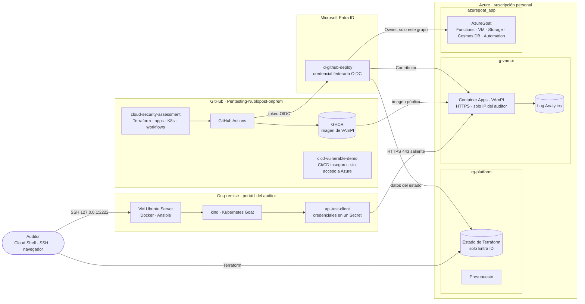

# Arquitectura del laboratorio

NubloPost, S.L. (escenario descrito en el [README](../README.md)) combina un centro de datos propio con Kubernetes y servicios en Azure desplegados desde GitHub. El laboratorio reproduce esa arquitectura con componentes vulnerables a propósito para evaluarla en caja blanca.

## Vista general

## Componentes

| Dominio | Componente | Función | Definido en |
|---|---|---|---|
| On-premise | VM Ubuntu Server 24.04 (VirtualBox) | Servidor del centro de datos | `onprem/ansible/` |
| On-premise | kind + Kubernetes Goat | Clúster con cargas vulnerables | `onprem/kubernetes/` |
| On-premise | `api-test-client` | Servicio interno que consume la API de Azure | `onprem/kubernetes/api-test-client/` |
| Azure | Plataforma: estado de Terraform, identidad OIDC, presupuesto | Base común, fuera de la explotación | `terraform/platform/` |
| Azure | VAmPI en Container Apps | API pública de NubloPost | `terraform/vampi/`, `applications/vampi/` |
| Azure | AzureGoat | Aplicación web y servicios de NubloPost | `terraform/azuregoat/` |
| GitHub | Repositorio principal, Actions y GHCR | Código, automatización e imágenes | `.github/workflows/` |
| GitHub | `cicd-vulnerable-demo` | Escenarios de CI/CD inseguros, aislados de Azure | Repositorio aparte |
| Entra ID | `id-github-deploy` | Identidad de despliegue sin secretos | `terraform/platform/` |

## Identidades y permisos

| Identidad | Tipo | Permisos | Uso |
|---|---|---|---|
| Auditor | Usuario de Entra ID | Propietario de la suscripción; datos del estado | Bootstrap y despliegues manuales desde Cloud Shell |
| `id-github-deploy` | Identidad administrada con OIDC | Contributor en `rg-vampi`, Owner en `azuregoat_app`, datos del estado | Despliegues desde GitHub Actions (environment `azure-lab`) |
| `GITHUB_TOKEN` | Token efímero de Actions | `contents: read`, `packages: write` | Publicar la imagen de VAmPI |
| Usuarios de VAmPI | Cuentas de la aplicación | Según VAmPI (incluye administrador) | Pruebas de la API |
| Cuentas de servicio de Kubernetes Goat | ServiceAccount | Una con `cluster-admin` (escenario `insecure-rbac`) | Escenarios vulnerables |
| Identidades de AzureGoat | Identidades administradas | Definidas por AzureGoat | Escenarios vulnerables |

## Flujos principales

1. **Plataforma (manual, una vez):** el auditor aplica `terraform/platform` desde Cloud Shell y el estado se migra al Storage de `rg-platform`.
2. **Imagen de VAmPI:** un push a `main` que toca `applications/vampi/` lanza `build-vampi`, que publica la imagen en GHCR; Container Apps la descarga sin credenciales.
3. **Despliegues:** VAmPI y AzureGoat se aplican desde Cloud Shell; en la fase de CI/CD pasan a GitHub Actions con OIDC.
4. **Conexión híbrida:** `api-test-client` resuelve el FQDN de Container Apps, sale por HTTPS 443 con la IP pública de casa (la única permitida) y se autentica con las credenciales de su Secret.
5. **Pruebas:** SSH a la VM, túnel SSH a los escenarios de Kubernetes Goat, HTTPS a VAmPI y AzureGoat, y lectura de la configuración de Azure.

## Fronteras de confianza

| # | Frontera | Qué la protege | Qué se evalúa |
|---|---|---|---|
| F1 | Portátil ↔ VM | NAT de VirtualBox; solo SSH en 127.0.0.1 con clave | Hardening del servidor (SSH, Docker) |
| F2 | Pods ↔ nodo de kind | Aislamiento de contenedores; los nodos de kind son contenedores privilegiados | RBAC, Secrets, contenedores privilegiados, escapes |
| F3 | On-premise ↔ Azure | HTTPS saliente, lista de IPs, credenciales de la API | Cadena on-prem → cloud a través del Secret |
| F4 | Internet ↔ servicios de Azure | Configuración de cada servicio; AzureGoat expuesto a propósito | Exposición, almacenamiento, identidades |
| F5 | GitHub ↔ Azure | OIDC por environment; roles por grupo de recursos | Confianza OIDC, permisos de workflows, secretos |
| F6 | Estado de Terraform | Entra ID y RBAC, sin claves; versionado | Secretos en el estado, acceso al Storage |

## Decisiones de diseño y riesgos aceptados

| Decisión | Motivo | Riesgo aceptado o mejora TO-BE |
|---|---|---|
| Una raíz de Terraform por pila | AzureGoat exige `azurerm ~> 3.11`; el resto usa la 5.x | — |
| Terraform desde Azure Cloud Shell | Herramientas listas y sin estado ni claves en el portátil u OneDrive | TO-BE: todo desde el pipeline |
| Storage del estado con endpoint público | Los runners de GitHub no tienen IP fija | TO-BE: endpoint privado y runner propio |
| Owner en `azuregoat_app` para la identidad de despliegue | AzureGoat crea asignaciones de roles | Escalada posible dentro de ese grupo |
| Container Apps con escala a cero | Coste casi nulo | La base de datos de VAmPI se reinicia y se recrea con `/createdb` |
| Lista de IPs en lugar de VPN | Simplicidad y coste | Depende de la IP de casa, que puede cambiar |
| Laboratorio dentro de una VM | Aislar el portátil | F1 es la frontera crítica: snapshot antes de cada sesión |

## AS-IS y TO-BE

Las vulnerabilidades de AzureGoat, VAmPI y Kubernetes Goat, junto con los escenarios de `cicd-vulnerable-demo`, forman el estado AS-IS y no se corrigen en origen. El TO-BE se documenta por hallazgo en `reports/remediation/` y se demuestra en los componentes propios (plataforma, pipeline seguro, cliente endurecido, políticas de Kubernetes). El detalle de red está en [network-design.md](network-design.md).
