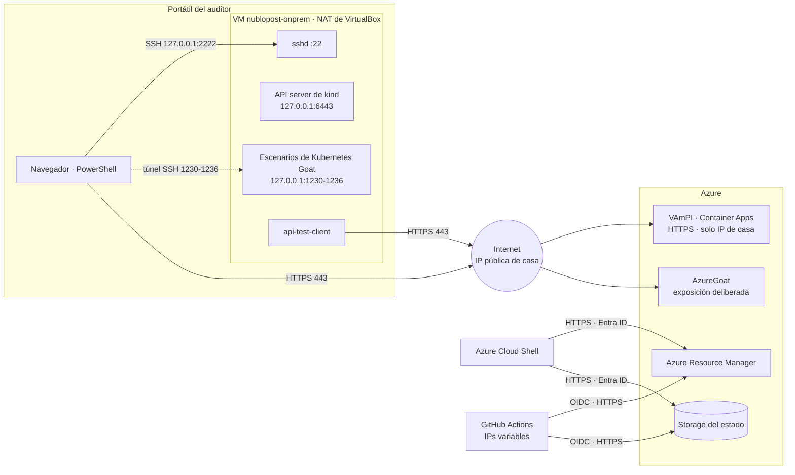

# Diseño de red

**Principio:** ningún componente del laboratorio acepta conexiones desde Internet sin restricción, salvo AzureGoat, cuya exposición es precisamente lo que se audita. El on-premise solo sale hacia Internet: no hay VPN ni puertos entrantes.

## Diagrama

## Flujos de red

| # | Origen | Destino | Puerto | Propósito | Control |
|---|---|---|---|---|---|
| N1 | Portátil | VM (`sshd`) | TCP 2222 → 22, solo en 127.0.0.1 | Administración | Clave ed25519; sin contraseñas ni root |
| N2 | Portátil | Escenarios de Kubernetes Goat | Túnel SSH, 1230-1236 | Pruebas de Kubernetes | Port-forwards solo en 127.0.0.1 de la VM |
| N3 | VM | API server de kind | 127.0.0.1:6443 | `kubectl` | Solo loopback; certificados de cliente |
| N4 | Pods | Internet | 443 saliente, NAT | Conexión híbrida, imágenes | Sin filtrado de salida (TO-BE) |
| N5 | `api-test-client` | VAmPI | HTTPS 443 | Consumo de la API | Lista de IPs y credenciales de la API |
| N6 | Auditor | VAmPI y AzureGoat | HTTPS 443 | Pruebas | VAmPI: lista de IPs. AzureGoat: expuesto |
| N7 | Cloud Shell | ARM y Storage del estado | HTTPS 443 | Terraform | Entra ID; rol de datos sobre el estado |
| N8 | GitHub Actions | Entra ID, ARM y Storage del estado | HTTPS 443 | Despliegues (fase CI/CD) | OIDC por environment; roles por grupo |
| N9 | Container Apps | GHCR | HTTPS 443 | Descarga de la imagen | Paquete público, sin credenciales |

La IP pública de casa es dinámica: si cambia, VAmPI responde 403 hasta que se vuelve a aplicar `terraform/vampi` con la nueva.

## Exposición a Internet

| Servicio | Expuesto | Restricción |
|---|---|---|
| VM on-premise | No | NAT; SSH solo desde el propio portátil |
| API server de kind | No | 127.0.0.1 |
| Escenarios de Kubernetes Goat | No | 127.0.0.1 y túnel SSH |
| VAmPI | Sí, HTTPS | Solo la IP de casa; el resto recibe 403 |
| Storage del estado | Endpoint público | Sin acceso anónimo ni claves; Entra ID y RBAC |
| AzureGoat | Sí | Ninguna: es el estado AS-IS que se evalúa |

## DNS

- **VAmPI:** FQDN de Container Apps (`*.azurecontainerapps.io`) con certificado gestionado por Azure.
- **Desde los pods:** CoreDNS → DNS de Docker en el nodo de kind → resolutor de la VM → DNS de VirtualBox → resolutor del portátil.

## Lo que no hay, a propósito

- VPN o red privada entre el on-premise y Azure.
- Puertos entrantes hacia la VM, salvo el SSH local.
- Runner de GitHub autoalojado.
- API server de Kubernetes expuesto.

## TO-BE de red

- NetworkPolicy de salida en `nublopost-client`: solo DNS y HTTPS hacia VAmPI.
- NetworkPolicies entre los namespaces de Kubernetes Goat (el CNI de kind las aplica).
- Endpoint privado para el Storage del estado, con runner propio.
- VAmPI detrás de un WAF, o con ingress interno si la API no tiene que ser pública.
- Corrección de la exposición de AzureGoat según los hallazgos.
