# Informe de pentest de caja blanca · NubloPost, S.L.

**Cloud Security Assessment: White-Box Pentesting & CI/CD Security**

| | |
|---|---|
| **Autor** | Cristian Rodríguez |
| **Proyecto** | Proyecto final de Pentesting (bootcamp de ciberseguridad) |
| **Cliente** | NubloPost, S.L. (empresa ficticia) |
| **Repositorio** | https://github.com/Pentesting-Nublopost-onprem/cloud-security-assessment |
| **Versión** | 1.0 |
| **Confidencialidad** | Laboratorio formativo. URLs, IPs, identificadores, tokens y contraseñas aparecen ocultos |

## Índice

1. Introducción y alcance
2. Resumen ejecutivo
3. Metodología
4. Fase 1 · Reconocimiento: arquitectura e inventario
5. Fase 2 · Escaneo y enumeración
6. Fase 3 · Obtención de acceso: hallazgos principales
7. Fases 4 y 5 · Mantenimiento del acceso y borrado de huellas
8. Criptografía
9. Hallazgos complementarios
10. Matriz de cobertura: herramientas frente a prueba manual
11. Conclusiones
- Anexo A · Entorno y versiones
- Anexo B · Índice de evidencias
- Anexo C · Repositorio
- Bibliografía

---

## 1. Introducción y alcance

### 1.1 Objetivo

En este proyecto simulo un pentest profesional de caja blanca sobre la infraestructura de NubloPost, S.L., una empresa con una parte on-premise (Kubernetes), servicios en Azure y el código en GitHub. Con el informe respondo a cuatro preguntas:

- ¿Puede un atacante tomar cuentas de usuario o de administrador?
- ¿Hasta dónde puede escalar privilegios desde un punto de apoyo pequeño?
- ¿Un fallo en el servidor on-premise da acceso a la nube?
- ¿Qué detectan las herramientas automáticas y qué solo aparece en la prueba manual?

### 1.2 Escenario: NubloPost, S.L.

NubloPost es una startup de unos 35 empleados con una plataforma de publicación de contenidos para creadores. No tiene equipo de seguridad: la infraestructura la mantienen 4 desarrolladores con perfil DevOps, que priorizan la velocidad de desarrollo. La aplicación web y la API de catálogo están en Azure; un pequeño servidor on-premise con Kubernetes ejecuta servicios internos que consumen esa API; el código y la automatización están en GitHub.

### 1.3 Cambio respecto a la práctica 14 (Active Directory)

El proyecto del curso parte de una red empresarial con Active Directory. Yo la he sustituido por un entorno **híbrido on-premise + Azure** por dos motivos:

1. **Perfil profesional:** trabajo en seguridad cloud (Azure, Terraform y Kubernetes) y es el entorno que quiero saber auditar.
2. **Dónde está hoy la identidad:** en muchas empresas, los privilegios ya no viven solo en un Active Directory local, sino en Entra ID, en identidades administradas y en el RBAC de Azure y de Kubernetes.

Los conceptos de un pentest de Active Directory tienen su equivalente en este laboratorio:

| En Active Directory | En este laboratorio |
|---|---|
| Controlador de dominio expuesto | Function App pública de AzureGoat (perímetro) |
| Grupos y ACL | RBAC de Azure y de Kubernetes |
| Cuenta de servicio con demasiados privilegios | Identidad administrada o ServiceAccount con `cluster-admin` |
| Escalada abusando de un servicio con más privilegios | Escalada de Contributor a Owner a través de Azure Automation; escape de contenedor al nodo |
| Movimiento lateral por la red | Pivote on-premise → Azure con credenciales robadas |
| Credenciales en scripts o en SYSVOL | Credenciales en Secrets de Kubernetes, ficheros desplegados y código |

**Para calibrar la dificultad:** los tres objetivos son laboratorios vulnerables públicos (AzureGoat de INE, Kubernetes Goat y VAmPI), así que sus vulnerabilidades son conocidas. Mi trabajo propio está en:

- **Desplegarlos hoy.** El AzureGoat original ya no se despliega tal cual: tuve que hacer cambios mínimos (runtimes retirados, imágenes y tamaños de VM no disponibles, región saturada) que no tocan sus vulnerabilidades. Los documento uno a uno en `terraform/azuregoat/UPSTREAM.md`.
- **Integrarlos en una arquitectura única**, que definí como código (Terraform y Ansible), con un pipeline de escáneres de seguridad en GitHub Actions.
- **La cadena on-premise → Azure del hallazgo K8S-1**, que no forma parte de ningún laboratorio: la diseñé yo al conectar el clúster con la API.
- **La comparación** entre lo que detectan los escáneres y lo que solo aparece en la prueba manual.

### 1.4 Alcance

| Dentro del alcance | Fuera del alcance |
|---|---|
| Azure, grupo `azuregoat_app`: AzureGoat (Function Apps, Storage, Cosmos DB, VM, Automation, identidades y RBAC) | Recursos de terceros, corporativos o de cualquier empleador |
| Azure, grupo `rg-vampi`: API de catálogo (VAmPI) en Container Apps | Infraestructura de Microsoft y de GitHub |
| Azure, grupo `rg-platform`: estado de Terraform y presupuesto (**solo revisión**, sin explotación) | Denegación de servicio y pruebas destructivas |
| On-premise: VM Ubuntu Server, clúster kind, Kubernetes Goat y el cliente `api-test-client` | Ingeniería social |
| GitHub: el repositorio del proyecto y sus workflows (revisión de configuración) | Escenarios de CI/CD vulnerables (quedan como ampliación) |
| Código: AzureGoat, VAmPI, Terraform y manifiestos de Kubernetes | Persistencia fuera del laboratorio |

### 1.5 Enfoque y reglas de compromiso

- **Caja blanca con brecha asumida:** como auditor, puedo leer el repositorio (Terraform, código y workflows) y tengo una identidad de solo lectura sobre el laboratorio de Azure. Los ataques los hago con la identidad que tendría un atacante en cada punto (una cuenta registrada en la aplicación, el token de una cuenta de servicio, la identidad de la VM).
- **Laboratorio propio:** mi suscripción personal de Azure, una VM en mi portátil y mis repositorios. Los recursos de Azure solo están encendidos durante las pruebas, y AzureGoat lo destruí al terminar.
- **Exposición mínima:** la API de catálogo solo acepta conexiones desde mi IP; el API server de Kubernetes solo escucha en la VM.
- **Sin daño:** sin denegación de servicio; documento y revierto los cambios en la misma sesión, y no borro los registros de auditoría.
- **Evidencias:** las guardo fuera del control de versiones y las publico con URLs, IPs, identificadores, tokens y contraseñas ocultos.

Reglas completas: `architecture/scope.md` en el repositorio.

---

## 2. Resumen ejecutivo

He evaluado con una metodología de caja blanca la infraestructura de NubloPost: la aplicación web en Azure, la API de catálogo y el clúster Kubernetes on-premise.

**Resultado: 7 vulnerabilidades principales demostradas (6 críticas y 1 alta)** y 20 hallazgos complementarios.

| ID | Vulnerabilidad | Severidad | CVSS |
|---|---|---|---|
| K8S-1 | Una cuenta de servicio con permisos de administrador da las credenciales de la API y, con ellas, acceso a Azure | **Crítica** | 9.9 |
| K8S-2 | Un contenedor privilegiado da el control del nodo y de todo el clúster | **Crítica** | 9.9 |
| AZ-1 | La aplicación web descarga cualquier URL (SSRF) y entrega las claves de Storage, Cosmos DB y de firma de tokens | **Crítica** | 9.9 |
| AZ-2 | Un contenedor de Storage público guarda claves SSH privadas que abren la VM desde Internet | **Crítica** | 9.3 |
| AZ-3 | La identidad de la VM se convierte en Owner del grupo de recursos a través de Azure Automation | **Crítica** | 9.1 |
| API-2 | Inyección SQL: cualquiera, sin iniciar sesión, obtiene todos los usuarios y sus contraseñas | **Crítica** | 9.1 |
| API-1 | Cualquier usuario registrado cambia la contraseña de otro y le quita la cuenta | **Alta** | 8.1 |

**Lo más grave, en pocas palabras:**

1. **Dos caminos distintos llevan al control total de Azure.** Desde Internet, sin credenciales previas, llegué a una shell en la VM (AZ-2) y de ahí a Owner del grupo de recursos (AZ-3). Por otro lado, la aplicación web entrega las claves de todos los datos (AZ-1).
2. **Del servidor interno a la nube.** Un fallo de permisos en el Kubernetes on-premise permite leer las credenciales que el servicio interno usa para la API de Azure, y entrar en ella (K8S-1). Un contenedor mal configurado da además el control permanente del clúster (K8S-2).
3. **La API expone todas las cuentas.** Sin iniciar sesión pude leer los usuarios y las contraseñas, guardadas sin cifrar, incluida la del administrador (API-2). Además, cualquier usuario puede cambiar la contraseña de otro (API-1).

**Lo que funciona bien:** el cifrado en tránsito que gestiona Azure (nota A en la API y en la aplicación web); la restricción por IP de la API, que impidió usar las credenciales robadas desde fuera de la red autorizada; la protección de push de GitHub, que bloqueó la subida de una clave; y el registro de actividad de Azure, que dejó rastro de toda la escalada.

**Prioridades de corrección:**

| # | Acción | Hallazgos | Esfuerzo |
|---|---|---|---|
| 1 | Quitar el rol Owner a la identidad de Automation (con Reader le basta) y el rol Contributor a la identidad de la VM | AZ-3 | Bajo |
| 2 | Hacer privados los contenedores de Storage, sacar las claves SSH, cerrar el puerto 22 a Internet y rotar todas las claves expuestas | AZ-2, AZ-1 | Bajo |
| 3 | Validar las URLs en la aplicación, no desplegar `local.settings.json` y llevar los secretos a Azure Key Vault con identidades administradas | AZ-1 | Medio |
| 4 | Consultas SQL parametrizadas, contraseñas con hash (argon2id o bcrypt), autorización por objeto y modo depuración desactivado en la API | API-1, API-2 | Bajo |
| 5 | Quitar `cluster-admin` a la cuenta `superadmin`, credenciales en Key Vault y Pod Security Admission `restricted` en el clúster | K8S-1, K8S-2 | Medio |
| 6 | Hacer obligatorios en el pipeline los escáneres que ya detectan parte de estos fallos (Checkov, Gitleaks, Kubescape) y alertar sobre asignaciones de rol | Prevención y detección | Medio |

---

## 3. Metodología

He seguido las cinco fases de la metodología CEH (EC-Council), adaptadas a caja blanca:

| Fase CEH | Qué hice | Herramientas | Sección |
|---|---|---|---|
| 1 · Reconocimiento | Inventario de activos y arquitectura a partir del repositorio, de Azure y del clúster | Lectura del código, Azure CLI, kubectl | 4 |
| 2 · Escaneo y enumeración | Escáneres del pipeline, Kubescape sobre el clúster, servicios expuestos y criptografía | Checkov, Semgrep, Trivy, Gitleaks, Kubescape, Nmap, ssh-audit, testssl.sh | 5 |
| 3 · Obtención de acceso | Prueba de concepto de cada hallazgo principal, incluida la escalada | curl, jq, kubectl, Azure CLI, ssh | 6 |
| 4 · Mantenimiento del acceso | Cómo mantendría el acceso un atacante con el rol Owner y cómo se detectaría | — | 7 |
| 5 · Borrado de huellas | Qué registra el Activity Log de la escalada y qué la detectaría. No borré ningún registro | Activity Log | 7 |

**Áreas de prueba:**

| Área | Objetivo |
|---|---|
| Azure (AzureGoat) | Aplicación web, Storage, VM, identidades y Automation |
| Kubernetes on-premise | Clúster kind con Kubernetes Goat y el cliente de la API |
| API (VAmPI) | API de catálogo en Container Apps (OWASP API Security Top 10) |

**Criterios:**

- **Severidad:** CVSS v3.1; calculé el vector y la puntuación base con la especificación de FIRST. Crítica ≥ 9.0 · Alta 7.0–8.9 · Media 4.0–6.9 · Baja < 4.0. Los hallazgos complementarios llevan una valoración cualitativa.
- **Formato de cada hallazgo:** qué es, dónde está, cómo lo encontré (paso a paso), impacto y remediación.
- **Re-test:** no he desplegado las correcciones, así que el re-test queda pendiente. Cada hallazgo incluye la corrección exacta.
- **Evidencias:** salidas de terminal en texto y capturas de los momentos clave. Las capturas publicadas están en `reports/final-report/evidencias/` (Anexo B).

---

## 4. Fase 1 · Reconocimiento: arquitectura e inventario

En caja blanca, el reconocimiento empieza por el propio repositorio: el Terraform describe qué hay en Azure, los manifiestos describen el clúster y el código muestra cómo trata cada aplicación los datos. Después lo contrasté con lo desplegado (Azure CLI y `kubectl`).

### 4.1 Arquitectura


| Bloque | Componente | Versión o detalle |
|---|---|---|
| On-premise | VM Ubuntu Server (VirtualBox), configurada con Ansible | Ubuntu 24.04 LTS |
| On-premise | Clúster kind de un solo nodo (plano de control y cargas en el mismo nodo) | Kubernetes v1.37.0 · containerd 2.3.4 · nodo Debian 13 |
| On-premise | Kubernetes Goat (escenarios vulnerables) | Commit `723a0db` |
| On-premise | `api-test-client`: servicio interno que llama a la API de Azure | Credenciales en un Secret del namespace `nublopost-client` |
| Azure | API de catálogo: VAmPI en Container Apps, solo HTTPS y solo la IP autorizada | Commit `f16052d` · Python 3.11.18 · Werkzeug 2.2.3 |
| Azure | Aplicación web: AzureGoat (dos Function Apps, Storage, Cosmos DB, VM Ubuntu 22.04, cuenta de Automation e identidades administradas) | Commit `b970459` con los cambios de despliegue de `UPSTREAM.md` |
| Azure | Plataforma: estado de Terraform (solo Entra ID, sin claves) y presupuesto | Fuera de la explotación |
| GitHub | Actions: imagen de VAmPI y escáneres de seguridad | GitHub no tiene credenciales de Azure |

### 4.2 Fronteras de confianza

| # | Frontera | Qué se evalúa |
|---|---|---|
| F1 | Portátil ↔ VM | Bastionado del servidor (SSH, Docker) |
| F2 | Contenedores ↔ nodo de Kubernetes | RBAC, Secrets, contenedores privilegiados y escapes (K8S-1, K8S-2) |
| F3 | On-premise ↔ Azure | La cadena a través del Secret de la API (K8S-1) |
| F4 | Internet ↔ servicios de Azure | Exposición, almacenamiento e identidades (AZ-1 a AZ-3, API-1, API-2) |
| F5 | GitHub → Azure | Permisos de los workflows, secretos en el repositorio e imagen de GHCR |
| F6 | Estado de Terraform | Secretos en el estado y acceso al Storage |

### 4.3 Inventario de Azure

Con `terraform output` y `az resource list` saqué el inventario del grupo `azuregoat_app`: dos Function Apps (la web en Node y la API de datos en Python), una cuenta de Storage, Cosmos DB, la VM `developerVM` con IP pública, la red y su NSG, una cuenta de Automation con el runbook `Get-AzureVM` y una identidad administrada asignada por el usuario.

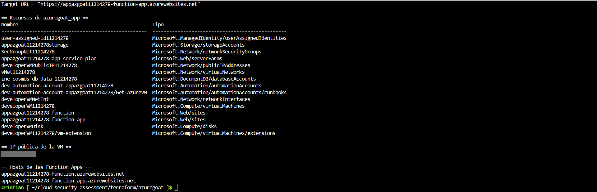

*Figura 1 · Inventario del grupo `azuregoat_app` desde Cloud Shell. La IP pública de la VM aparece oculta.*

### 4.4 Qué marcó el reconocimiento

Al revisar el repositorio y lo desplegado marqué estas zonas para las fases siguientes:

- **Azure:** la función `download_url` de la API descarga cualquier URL; el Terraform crea contenedores de Storage con acceso público y una VM con contraseña y SSH abierto a Internet; la identidad de la VM tiene Contributor y la de Automation, Owner.
- **Kubernetes:** una ServiceAccount de `kube-system` ligada a `cluster-admin`, un Deployment con `privileged: true` y el disco del nodo montado, y unas credenciales de un servicio de Azure guardadas como Secret.
- **API:** VAmPI arranca Flask en modo depuración (`app.py`, `debug=True`) con el servidor de desarrollo, firma los tokens con una clave fija en el código y guarda las contraseñas sin hash.

---

## 5. Fase 2 · Escaneo y enumeración

### 5.1 Pipeline de escáneres (`security-scan`)

En cada subida a GitHub, el workflow `security-scan` ejecuta cuatro escáneres sobre el código del repositorio, sin desplegar nada, y publica los resultados en *Security → Code scanning*. Para el análisis también los ejecuté en local, con las mismas versiones, sobre el código final:

| Herramienta | Qué revisa | Resultado |
|---|---|---|
| Checkov 3.4.3 | Terraform, manifiestos de Kubernetes, Dockerfile, Ansible y workflows | 53 controles fallidos: 37 en AzureGoat, 7 en la plataforma, 7 en `api-test-client` y 2 en el Dockerfile de VAmPI. 0 en los workflows y en Ansible |
| Semgrep 1.184.0 | Código de VAmPI, de las Functions de AzureGoat y del cliente on-premise | 5 resultados: el SSRF de AZ-1, la clave JWT fija de VAmPI y 3 de calidad de código |
| Gitleaks 8.30.1 | Secretos en todo el historial de Git | 9 resultados: las 8 claves SSH privadas de AZ-2 y un JWT de ejemplo en la especificación de VAmPI |
| Trivy 0.76.2 | Dependencias e imagen de VAmPI | Se ejecuta en el pipeline. En local no pude descargar su base de datos, así que revisé las dependencias con la base de vulnerabilidades de PyPI y con `npm audit`: versiones antiguas con CVE conocidas en las dos aplicaciones (sección 9) |

En local usé con Semgrep las reglas públicas de Python y JavaScript del repositorio `semgrep-rules`, porque el registro de reglas no era accesible desde mi entorno de análisis. El pipeline usa los conjuntos `p/python`, `p/flask` y `p/owasp-top-ten`, así que su número de resultados puede variar.

Los resultados que corresponden a hallazgos principales están en la matriz de cobertura (sección 10); el resto, en los hallazgos complementarios (sección 9).

### 5.2 Kubescape sobre el clúster

Kubescape (CNCF) revisa los recursos desplegados contra controles de NSA/CISA y MITRE ATT&CK. Lancé los cinco controles relacionados con los hallazgos de Kubernetes:

```bash
kubescape scan control C-0035,C-0015,C-0057,C-0038,C-0048
```

| Severidad | Control | Recursos que fallan | Hallazgo |
|---|---|---|---|
| Alta | C-0015 · List Kubernetes secrets | 10 de 84 | K8S-1 |
| Media | C-0035 · Administrative Roles | 3 de 84 | K8S-1 |
| Alta | C-0057 · Privileged container | 3 de 20 | K8S-2 |
| Alta | C-0038 · Host PID/IPC privileges | 1 de 20 | K8S-2 |
| Alta | C-0048 · HostPath mount | 8 de 20 | K8S-2 |

Los 5 controles fallan (cumplimiento global del 84,9 %), y Kubescape señala exactamente los dos recursos de los hallazgos: la ServiceAccount `superadmin` (C-0035 y C-0015) y el Deployment `system-monitor-deployment` (C-0057, C-0038 y C-0048).

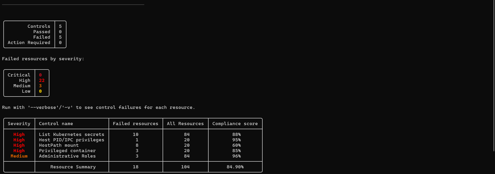

*Figura 2 · Resultado de los cinco controles de Kubescape.*

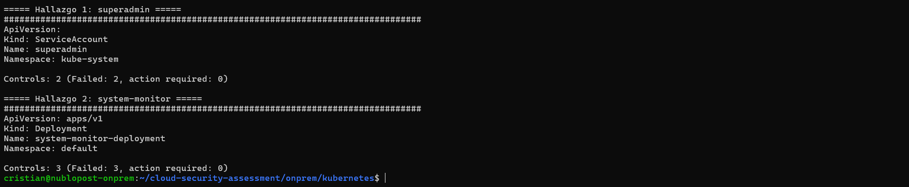

*Figura 3 · Kubescape señala la cuenta `superadmin` y el Deployment `system-monitor`.*

### 5.3 Servicios expuestos de la VM de Azure

Desde la VM on-premise escaneé la IP pública de la VM de AzureGoat:

```bash
nmap -sV -Pn -p 22,80,443 <IP de la VM>
ssh-audit <IP de la VM>
nmap -Pn -p 22 --script ssh-auth-methods --script-args ssh.user=azureuser <IP de la VM>
```

- **SSH abierto a Internet:** `22/tcp open ssh OpenSSH 8.9p1 Ubuntu 3ubuntu0.18`. Los puertos 80 y 443 aparecen filtrados por el NSG.
- **El SSH acepta contraseña** (`publickey` y `password`). El Terraform define la VM con `disable_password_authentication = false` y la contraseña escrita en el código.
- **Algoritmos SSH:** los de serie de Ubuntu 22.04, con algunos débiles (detalle en la sección 8).

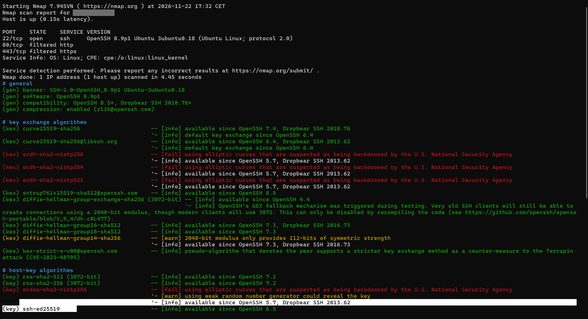

*Figura 4 · Nmap (SSH abierto, 80 y 443 filtrados) y comienzo del análisis de ssh-audit.*

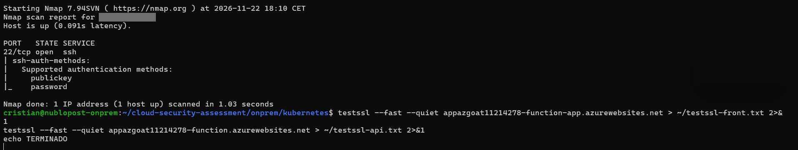

*Figura 5 · La VM acepta autenticación por contraseña desde Internet.*

### 5.4 TLS de los servicios web

Pasé `testssl.sh` a la API de catálogo y a las Function Apps: solo TLS 1.2 y 1.3, sin vulnerabilidades TLS conocidas y nota A en ambos casos, limitada por la falta de HSTS. Detalle en la sección 8.

---

## 6. Fase 3 · Obtención de acceso: hallazgos principales

| ID | Vulnerabilidad | Severidad | CVSS 3.1 |
|---|---|---|---|
| AZ-1 | SSRF en la Function App → credenciales de Storage, Cosmos DB y JWT | Crítica | 9.9 |
| AZ-2 | Contenedor de Storage público → clave SSH → acceso a la VM | Crítica | 9.3 |
| AZ-3 | Escalada de Contributor a Owner a través de Azure Automation | Crítica | 9.1 |
| K8S-1 | RBAC excesivo → Secret → acceso a la API de Azure | Crítica | 9.9 |
| K8S-2 | Contenedor privilegiado → nodo del clúster | Crítica | 9.9 |
| API-1 | Autorización rota a nivel de objeto (BOLA): cambio de la contraseña de otro usuario | Alta | 8.1 |
| API-2 | Inyección SQL con volcado de credenciales | Crítica | 9.1 |

### 6.1 Azure (AzureGoat)

Desplegué AzureGoat desde Azure Cloud Shell y lo destruí al terminar las pruebas. Hay dos caminos de ataque que acaban en el control del grupo de recursos:

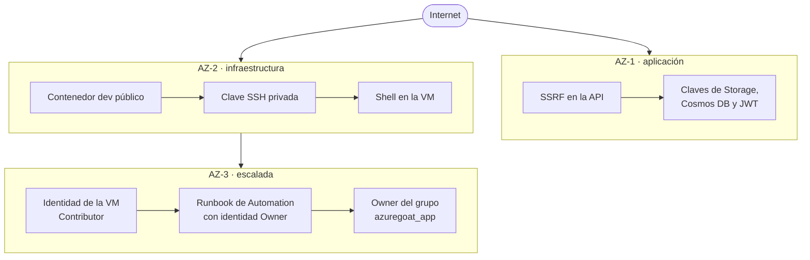

#### AZ-1 · SSRF en la Function App → robo de credenciales

| | |
|---|---|
| **Severidad** | Crítica · CVSS 3.1 **9.9** · `AV:N/AC:L/PR:L/UI:N/S:C/C:H/I:H/A:H` |
| **Dónde** | Function App de la API (Python), endpoint `GET /save-content?value=<URL>`, función `download_url` de `app/__init__.py` |
| **Fase CEH** | 1 (revisión del código) → 3 |
| **Referencias** | OWASP API7:2023 (SSRF) · CWE-918 · MITRE ATT&CK T1552.001 |
| **Detectado por** | Semgrep (`dynamic-urllib-use-detected`) señala la llamada. El robo de credenciales, solo con la prueba |
| **Re-test** | Pendiente; corrección propuesta abajo |

**Qué es.** En una falsificación de peticiones del lado del servidor (SSRF), la aplicación descarga una URL que elige el atacante. Si no valida el destino, se puede usar para leer recursos internos del propio servidor, incluidos sus ficheros locales.

**Dónde está.** La función que sube imágenes «desde una URL» (una funcionalidad de NubloPost para importar contenido) llama a `download_url`, que descarga cualquier URL con `urllib` sin validar el esquema ni el destino. `urllib` admite `file://`, así que también lee ficheros del servidor. El endpoint solo pide un JWT válido, y cualquiera lo obtiene registrándose.

**Cómo lo encontré.**

*Paso 1 · Indicio en el código.* En caja blanca, el código señala el punto vulnerable antes de atacar:

```python
def download_url(url):
    req = urllib.request.Request(url, headers={"User-Agent": "Magic Browser"})
    image = urllib.request.urlopen(req).read()
```

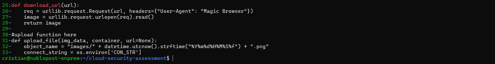

*Figura 6 · `download_url` descarga cualquier URL que recibe.*

*Paso 2 · Confirmar el SSRF leyendo un fichero local.* Registré un usuario propio, inicié sesión para obtener el JWT y pedí a la API que «descargara» un fichero del propio servidor:

```
POST /register                                   → {"body": "User Registered"}
POST /login                                      → token JWT
GET  /save-content?value=file:///etc/passwd      (cabecera JWT_TOKEN)
```

La API guarda lo descargado en el Storage como si fuera una imagen y devuelve su URL. Al abrirla apareció el contenido de `/etc/passwd`: el servidor lee ficheros locales por orden del atacante. Además, el fichero queda publicado en un blob que se lee sin autenticación.

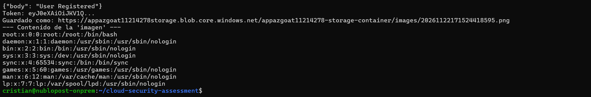

*Figura 7 · La «imagen» guardada por la API contiene `/etc/passwd`.*

*Paso 3 · Robo de credenciales.* Repetí el SSRF contra el fichero de configuración que se despliega junto al código de la función, `file:///home/site/wwwroot/local.settings.json`. En la evidencia, los valores aparecen recortados u ocultos:

```
"JWT_SECRET": "[OCULTO]",
"AZ_DB_ENDPOINT": "https://ine-***",
"AZ_DB_PRIMARYKEY": "[OCULTO]",
"CON_STR": "DefaultEndpo***",
"CONTAINER_NAME": "appazgoat112***"
```

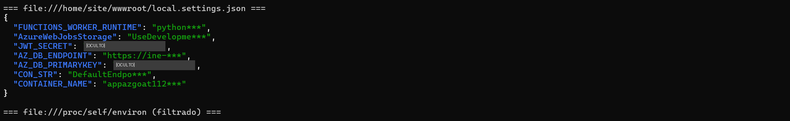

*Figura 8 · `local.settings.json` leído con el SSRF, con los secretos ocultos.*

Obtuve tres secretos: la cadena de conexión del Storage con la clave de la cuenta (`CON_STR`), la clave primaria de Cosmos DB (`AZ_DB_PRIMARYKEY`) y el secreto que firma los tokens de la aplicación (`JWT_SECRET`).

*Paso 4 · Usar la clave robada.* Solo con `CON_STR`, sin mi cuenta de auditor, listé los contenedores y los blobs del Storage (Azure CLI en Docker desde la VM on-premise):

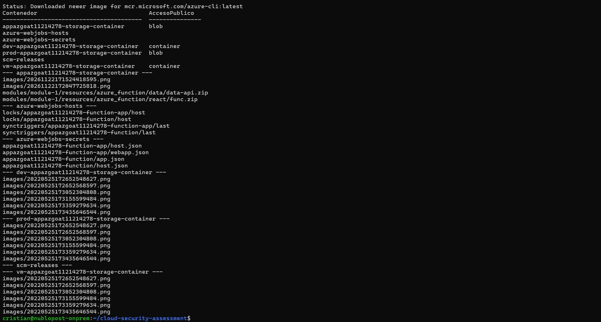

*Figura 9 · Siete contenedores visibles con la clave robada, incluidos los paquetes de código y los secretos internos de las Function Apps.*

**Impacto.** La clave de la cuenta da control total del Storage: leer, modificar y borrar todos los blobs, incluidos los paquetes de código de las funciones. La clave de Cosmos DB da lectura y escritura de todos los datos de usuarios. Con `JWT_SECRET` se pueden firmar tokens válidos de cualquier usuario, incluidos los administradores.

**Por qué esta severidad.** Hace falta una cuenta propia (PR:L, el registro es libre); el alcance pasa de la Function App al Storage y a Cosmos DB (S:C); las claves dan lectura, escritura y borrado de los datos (C:H, I:H, A:H).

**Remediación.**

1. Validar la URL antes de descargarla: solo `https` y solo dominios permitidos. Así quedan fuera `file://`, las IP internas y el servicio de metadatos. Si la descarga sigue redirecciones, hay que validar también el destino final.

   ```python
   from urllib.parse import urlparse

   DOMINIOS_PERMITIDOS = {"imagenes.nublopost.example"}

   def download_url(url):
       destino = urlparse(url)
       if destino.scheme != "https" or destino.hostname not in DOMINIOS_PERMITIDOS:
           raise ValueError("URL no permitida")
       req = urllib.request.Request(url, headers={"User-Agent": "Magic Browser"})
       return urllib.request.urlopen(req, timeout=10).read()
   ```

2. No desplegar `local.settings.json`: excluirlo del paquete (`excludes = ["local.settings.json"]` en el `archive_file` del Terraform) y llevar los secretos a Azure Key Vault con referencias de Key Vault en la configuración de la aplicación.
3. Sustituir las claves por identidades administradas con roles de datos, y desactivar la autenticación con clave: `shared_access_key_enabled = false` en el Storage y `local_authentication_disabled = true` en Cosmos DB.
4. Hacer privado el contenedor donde se guardan las imágenes subidas.
5. Rotar todas las claves expuestas y el secreto JWT.

#### AZ-2 · Contenedor de Storage público → clave SSH → acceso a la VM

| | |
|---|---|
| **Severidad** | Crítica · CVSS 3.1 **9.3** · `AV:N/AC:L/PR:N/UI:N/S:C/C:H/I:L/A:N` |
| **Dónde** | Contenedor `dev-…-storage-container` con acceso público de nivel `container`; VM `developerVM` con SSH abierto a Internet |
| **Fase CEH** | 2 → 3 |
| **Referencias** | CWE-552 (ficheros accesibles a terceros) · MITRE ATT&CK T1530 y T1552.004 |
| **Detectado por** | Checkov (contenedores públicos, acceso anónimo, SSH abierto) y Gitleaks (las 8 claves privadas en el repositorio). La cadena hasta la VM, solo con la prueba |
| **Re-test** | Pendiente; corrección propuesta abajo |

**Qué es.** Un contenedor de Storage con acceso público de nivel `container` deja que cualquiera, sin credenciales, liste y descargue su contenido. Si guarda claves privadas, cualquiera puede usarlas.

**Dónde está.** El contenedor `dev` (de «desarrollo», que nunca debería exponer datos) tiene acceso público. En él están las claves SSH del equipo y la configuración que indica qué clave abre qué máquina. La VM `developerVM` acepta SSH desde cualquier IP.

**Cómo lo encontré.**

*Paso 1 · Listado anónimo del contenedor.* En el paso 4 de AZ-1 vi que `dev` tiene acceso público. Lo comprobé sin ninguna credencial, con la API REST de Storage (`?restype=container&comp=list`):

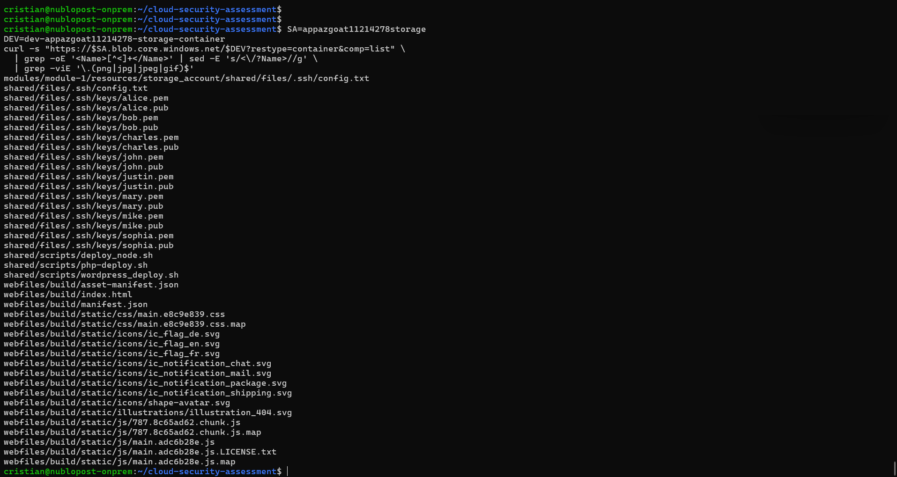

*Figura 10 · El contenedor `dev` se lista sin credenciales: 8 claves SSH privadas (`.pem`), su configuración y scripts de despliegue.*

*Paso 2 · Identificar la clave de la VM.* En lugar de probar las 8 claves a ciegas, descargué de forma anónima `config.txt`. La entrada de la VM de desarrollo (`VM_IP_ADDR`) usa la clave de `justin`. El script `deploy_node.sh` confirma la mala práctica: copia claves `.pem` a `authorized_keys`.

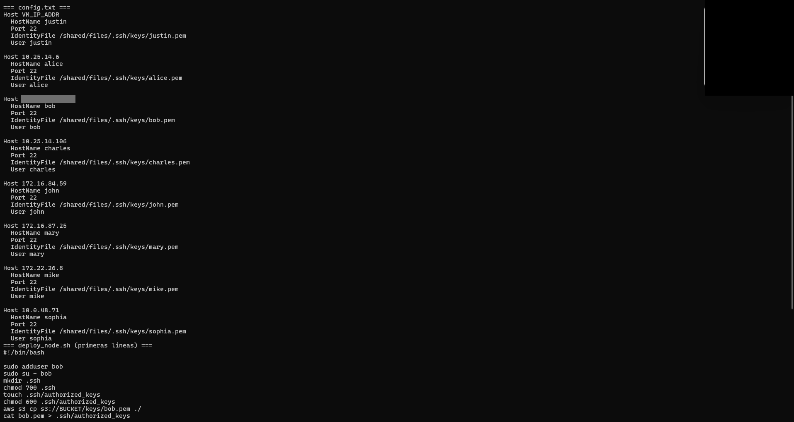

*Figura 11 · `config.txt` asocia la VM de desarrollo con la clave `justin.pem`.*

*Paso 3 · Acceso a la VM.* Descargué `justin.pem`, le di permisos `600` y entré por SSH ejecutando solo `whoami`, `hostname` e `id`:

```
[OK] Dentro de la VM:
justin
developerVM
uid=1001(justin) gid=1001(justin) groups=1001(justin)
```

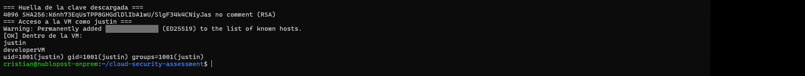

*Figura 12 · Shell en `developerVM` como `justin`, sin ninguna credencial previa.*

**Impacto.** Desde Internet y sin credenciales se obtiene una shell en un servidor de la empresa. La VM tiene una identidad administrada con permisos sobre Azure: es el punto de partida de AZ-3.

**Por qué esta severidad.** No requiere ninguna credencial (PR:N); el alcance pasa del Storage a la VM (S:C); se leen las claves y los datos de la VM (C:H) y, como usuario sin privilegios, se modifican solo sus ficheros (I:L).

**Remediación.**

1. Hacer privado el contenedor y prohibir el acceso anónimo en la cuenta:

   ```hcl
   resource "azurerm_storage_container" "storage_container_dev" {
     # ...
     container_access_type = "private"   # antes: "container"
   }

   resource "azurerm_storage_account" "storage_account" {
     # ...
     allow_nested_items_to_be_public = false   # antes: true
   }
   ```

2. No guardar claves privadas en Storage. Para administrar la VM, usar Azure Bastion o el inicio de sesión con Entra ID.
3. Cerrar el puerto 22 a Internet en el NSG (`source_address_prefix = "*"` → solo la IP de administración, o ninguna con Bastion), desactivar la contraseña (`disable_password_authentication = true`) y sacarla del Terraform.
4. Revocar las 8 claves expuestas y limpiar `authorized_keys`.

#### AZ-3 · Escalada de Contributor a Owner a través de Azure Automation

| | |
|---|---|
| **Severidad** | Crítica · CVSS 3.1 **9.1** · `AV:N/AC:L/PR:H/UI:N/S:C/C:H/I:H/A:H` |
| **Dónde** | Identidad administrada de la VM (Contributor sobre `azuregoat_app`) y cuenta de Automation `dev-automation-account-…` con una identidad Owner; runbook `Get-AzureVM` |
| **Fase CEH** | 3 |
| **Referencias** | CWE-269 · MITRE ATT&CK T1098 (manipulación de cuentas) |
| **Detectado por** | Ninguna herramienta: es un abuso de permisos legítimos. Solo prueba manual |
| **Re-test** | Pendiente; corrección propuesta abajo |

**Qué es.** Un caso de *confused deputy*: una identidad con pocos privilegios no puede asignarse roles, pero puede pedir a otra más potente que lo haga por ella. En Azure Automation, los runbooks se ejecutan con la identidad de la cuenta de Automation; quien puede editarlos ejecuta código con esos permisos.

**Dónde está.** La identidad de la VM tiene Contributor sobre el grupo de recursos, que permite editar y ejecutar runbooks pero no asignar roles. La cuenta de Automation usa una identidad con Owner sobre el mismo grupo.

**Cómo lo encontré.**

*Paso 1 · Identidad de la VM.* Dentro de la VM (como `justin`), inicié sesión con `az login --identity` usando la identidad administrada, sin ninguna contraseña: el token lo emite el servicio de metadatos de la VM. Sus roles: **Contributor** sobre `azuregoat_app`.

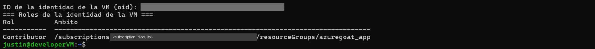

*Figura 13 · La identidad de la VM tiene Contributor sobre el grupo de recursos.*

*Paso 2 · Camino de escalada.* La cuenta de Automation tiene asociada la identidad `user-assigned-id…`, que tiene **Owner** sobre el mismo grupo, y un runbook existente, `Get-AzureVM`.

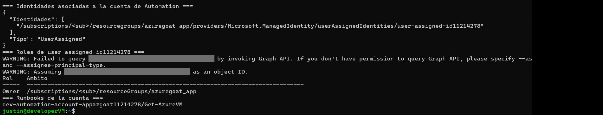

*Figura 14 · La identidad de Automation tiene Owner; su runbook `Get-AzureVM`.*

*Paso 3 · Sustituir el runbook.* Guardé una copia del runbook original y sustituí su contenido por un script que se autentica con la identidad Owner y asigna el rol Owner a la identidad de la VM; después lo publiqué. El original ya se autenticaba con esa misma identidad, lo que confirma que el runbook legítimo se ejecutaba como Owner.

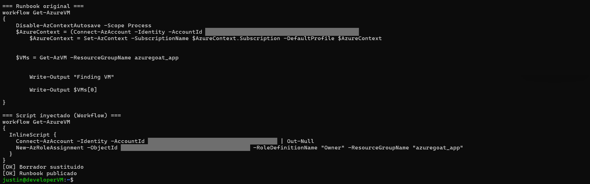

*Figura 15 · Runbook original (arriba) y el que asigna Owner a la identidad de la VM (abajo). Los identificadores aparecen ocultos.*

*Paso 4 · Ejecutar y comprobar.* Lancé un job del runbook, que pasa por `New → Activating → Running → Completed`, y volví a listar los roles de la identidad de la VM: ahora tiene **Contributor y Owner**.

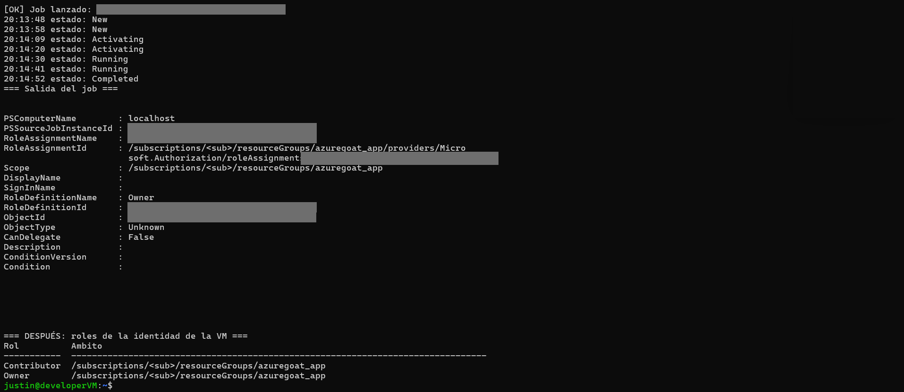

*Figura 16 · El job asigna Owner a la identidad de la VM; después, la identidad tiene los dos roles.*

*Paso 5 · Limpieza.* Restauré el runbook original desde la copia y borré la asignación de Owner creada. La identidad de la VM vuelve a tener solo Contributor.

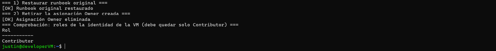

*Figura 17 · Runbook restaurado y asignación de Owner eliminada.*

**Impacto.** Partiendo de una shell en la VM (AZ-2), la identidad de la VM pasa a ser Owner del grupo de recursos: control total, incluida la asignación de roles a cualquier identidad. Cadena completa: Storage público → VM → identidad Contributor → runbook con identidad Owner → control de `azuregoat_app`.

**Por qué esta severidad.** Hace falta una identidad con permisos amplios sobre el grupo (PR:H, Contributor); el alcance pasa de la cuenta de Automation a todo el grupo de recursos (S:C); Owner da control total (C:H, I:H, A:H).

**Remediación.**

1. Mínimo privilegio en la identidad de Automation. El runbook solo lista máquinas virtuales, así que le basta con Reader:

   ```hcl
   resource "azurerm_role_assignment" "az_role_assgn_identity" {
     # ...
     role_definition_name = "Reader"   # antes: "Owner"
   }
   ```

2. Quitar Contributor a la identidad de la VM (`az_role_assgn_vm`); si necesita algo, un rol acotado al recurso concreto.
3. Separar quién puede editar runbooks (Automation Contributor) de las identidades privilegiadas que ejecutan.
4. Alertas sobre nuevas asignaciones de rol y cambios en runbooks (sección 7).

### 6.2 Kubernetes on-premise

Antes de empezar hice un snapshot de la VM: el hallazgo K8S-2 da privilegios sobre el nodo y la frontera real del laboratorio es la VM. El clúster estaba sano: un nodo `Ready` (Kubernetes v1.37.0), los escenarios de Kubernetes Goat y el pod `api-test-client` en ejecución.

#### K8S-1 · RBAC excesivo → Secret → acceso a la API de Azure

| | |
|---|---|
| **Severidad** | Crítica · CVSS 3.1 **9.9** · `AV:N/AC:L/PR:L/UI:N/S:C/C:H/I:H/A:H` |
| **Dónde** | Clúster kind: ServiceAccount `superadmin` (namespace `kube-system`) ligada a `cluster-admin`; Secret `vampi-credentials-*` (namespace `nublopost-client`); API de catálogo en Azure |
| **Fase CEH** | 1–2 (revisión del RBAC) → 3 |
| **Referencias** | CWE-269 · CWE-522 · MITRE ATT&CK T1552.007 |
| **Detectado por** | Kubescape (C-0035, C-0015) y revisión manual. La cadena hacia Azure, solo con la prueba |
| **Re-test** | Pendiente; corrección propuesta abajo |

**Qué es.** El RBAC de Kubernetes decide qué puede hacer cada identidad. `cluster-admin` es el equivalente a root: todos los permisos sobre todos los recursos. Si una cuenta de servicio lo tiene, cualquiera que consiga su token controla el clúster, incluidos los Secrets, que guardan credenciales.

**Dónde está.** El ClusterRoleBinding `superadmin` da `cluster-admin` a la ServiceAccount `superadmin` de `kube-system` (escenario `insecure-rbac` de Kubernetes Goat). En el mismo clúster, el servicio interno `api-test-client` guarda en un Secret el usuario y la contraseña con los que se conecta a la API de catálogo en Azure.

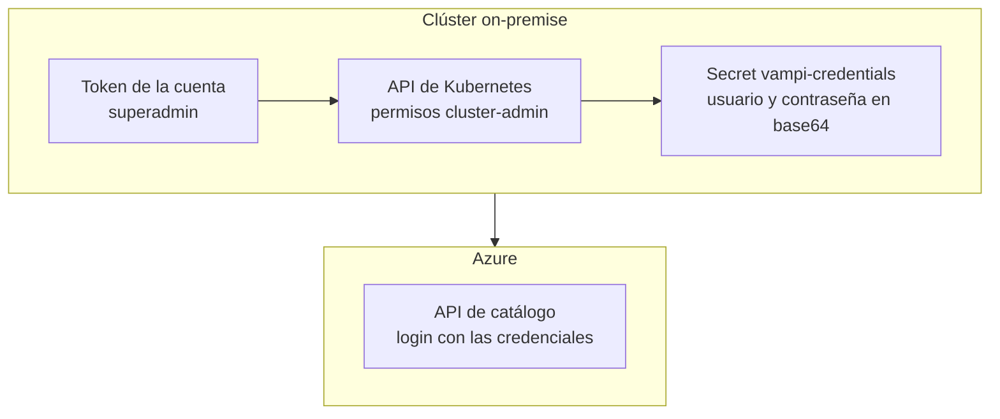

**Cómo lo encontré.**

*Paso 1 · Indicio: revisión del RBAC.* En caja blanca, lo primero es ver quién puede hacer qué:

```bash
kubectl get clusterrolebinding superadmin -o yaml
kubectl auth can-i --list --as=system:serviceaccount:kube-system:superadmin | head -15
```

El binding enlaza el ClusterRole `cluster-admin` con la ServiceAccount `superadmin`; se creó con `kubectl apply`, así que es configuración declarada a propósito. `auth can-i --list` devuelve `*.*  []  []  [*]`: todos los verbos sobre todos los recursos.

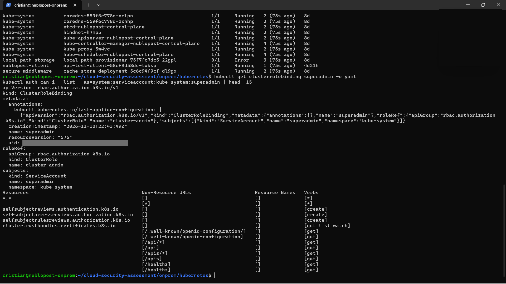

*Figura 18 · Binding de `cluster-admin` y permisos `*.*` de la cuenta `superadmin`.*

*Paso 2 · Con solo el token de la cuenta, listar los Secrets.* Un atacante real no tiene el kubeconfig de administrador, sino el token de una cuenta de servicio (montado en un pod comprometido o filtrado en un log). Para simular ese robo generé un token de `superadmin` y usé `curl` contra la API de Kubernetes **solo con ese token**:

```bash
TOKEN_SA=$(kubectl create token superadmin -n kube-system --duration=15m)
API=$(kubectl config view --minify -o jsonpath='{.clusters[0].cluster.server}')
curl -sk -H "Authorization: Bearer $TOKEN_SA" \
  $API/api/v1/namespaces/nublopost-client/secrets | jq -r '.items[].metadata.name'
```

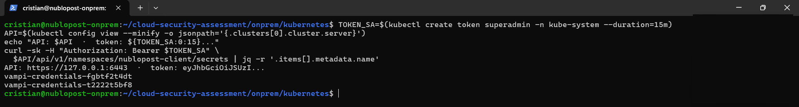

*Figura 19 · El token da acceso a los Secrets de otro namespace. Aparece también un Secret antiguo que no se borró.*

*Paso 3 · Leer el Secret en uso.* Con el mismo token consulté qué Secret usa el Deployment `api-test-client` y lo leí. Los Secrets de Kubernetes solo están codificados en base64, no cifrados: quien puede leerlos tiene las credenciales en claro. En la evidencia recorto la contraseña a 2 caracteres.

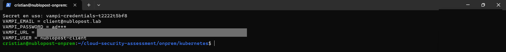

*Figura 20 · Credenciales de la API en el Secret (contraseña recortada; URL oculta).*

*Paso 4 · Usar las credenciales contra la API en Azure.* El primer intento devolvió `HTTP 403` del ingress de Container Apps: mi IP pública de casa había cambiado y ya no era la autorizada. Es una buena noticia para la defensa: con las credenciales robadas, pero desde fuera de la red autorizada, el atacante no llega a la API. Actualicé la regla con Terraform; el plan mostró además una deriva (Azure había añadido un `workload_profile` no declarado en el código, sin efecto funcional).

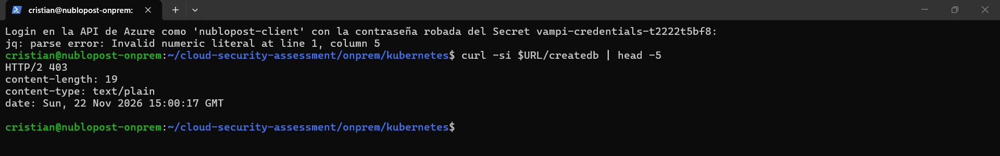

*Figura 21 · El ingress de la API rechaza una IP no autorizada.*

Después, desde la VM on-premise, inicié sesión en la API con el usuario y la contraseña del Secret:

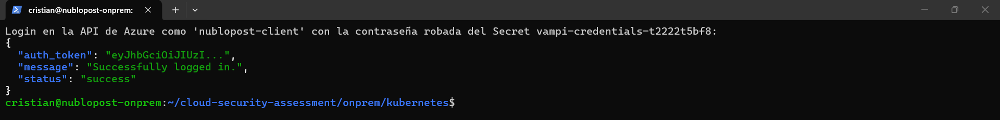

*Figura 22 · Login correcto en la API de Azure con las credenciales robadas del clúster.*

**Impacto.** Un fallo de mínimo privilegio en el clúster on-premise compromete las credenciales de un servicio en Azure. Con esa sesión, el atacante puede encadenar API-1 y API-2 para tomar otras cuentas y leer toda la base de datos de la API. El ataque solo prospera desde la red on-premise autorizada, que es justo donde está el clúster comprometido.

**Por qué esta severidad.** Hace falta el token de una cuenta (PR:L), y el alcance pasa del clúster on-premise al servicio en Azure (S:C).

**Remediación.**

1. Quitar el permiso de administrador: `kubectl delete clusterrolebinding superadmin`, y borrarlo de los manifiestos para que no vuelva.
2. Conceder solo Roles por namespace con los verbos y recursos mínimos. Nadie fuera de los administradores debe poder hacer `get` o `list` de Secrets a nivel de clúster.
3. Sacar las credenciales del clúster: guardarlas en Azure Key Vault y montarlas con el Secrets Store CSI Driver (o External Secrets). En Azure, sustituir usuario y contraseña por una identidad federada cuando el servicio lo permita.
4. Activar el cifrado de Secrets en reposo en etcd (`EncryptionConfiguration`, idealmente con un proveedor KMS).
5. Borrar el Secret antiguo (`kubectl delete secret vampi-credentials-fgbtf2t4dt -n nublopost-client`) y cambiar la contraseña de `nublopost-client` por una larga y aleatoria.
6. Ejecutar Kubescape en el pipeline o como control de admisión para que una configuración así no llegue al clúster.

#### K8S-2 · Contenedor privilegiado → nodo del clúster

| | |
|---|---|
| **Severidad** | Crítica · CVSS 3.1 **9.9** · `AV:N/AC:L/PR:L/UI:N/S:C/C:H/I:H/A:H` |
| **Dónde** | Deployment `system-monitor-deployment` (namespace `default`, escenario `system-monitor` de Kubernetes Goat) |
| **Fase CEH** | 2 (revisión de la especificación) → 3 |
| **Referencias** | CWE-250 · MITRE ATT&CK T1611 (escape al host) |
| **Detectado por** | Kubescape (C-0057, C-0038, C-0048) y revisión manual. El impacto, solo con la prueba |
| **Re-test** | Pendiente; corrección propuesta abajo |

**Qué es.** Un contenedor aísla un proceso del resto de la máquina. Opciones como `privileged: true`, compartir los procesos del nodo (`hostPID`) o montar el disco del nodo (`hostPath`) eliminan ese aislamiento: quien entra en el contenedor está, en la práctica, en el nodo.

**Dónde está.** El pod `system-monitor` se ejecuta con `privileged: true`, `hostPID: true`, `hostIPC: true` y el disco raíz del nodo (`/`) montado en `/host-system`. Ninguna política lo impide: el namespace no aplica Pod Security Admission.

**Cómo lo encontré.**

*Paso 1 · Indicio: la especificación del pod.* Antes de probar nada revisé las opciones que rompen el aislamiento:

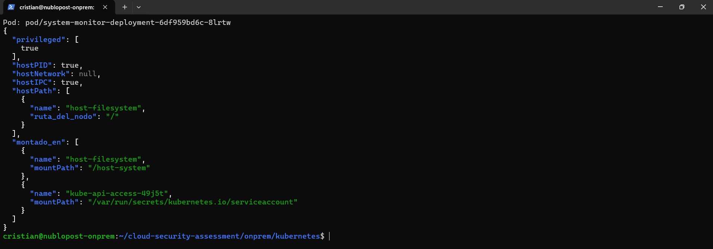

*Figura 23 · `privileged`, `hostPID`, `hostIPC` y el disco del nodo montado.*

*Paso 2 · Escape: `chroot` al disco del nodo.* Con `kubectl exec` entré en el pod y ejecuté `chroot /host-system`, que usa el sistema de ficheros del nodo como raíz. Para medir el impacto sin copiar secretos comparé la identidad y el sistema antes y después, y listé los manifiestos del plano de control y los **nombres** (no el contenido) de las claves de la CA:

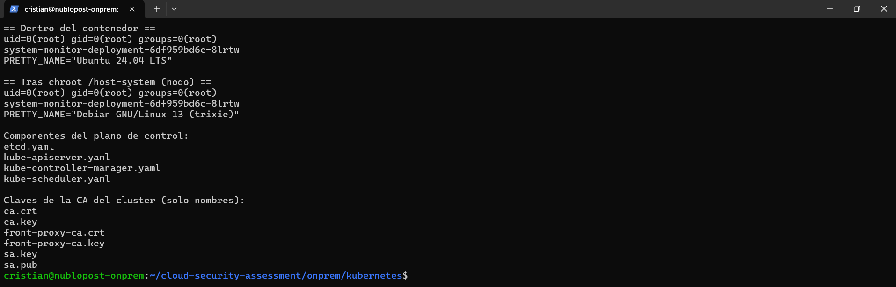

*Figura 24 · El sistema pasa de Ubuntu 24.04 (contenedor) a Debian 13 (nodo); manifiestos del plano de control y claves de la CA a la vista.*

El sistema operativo pasa de Ubuntu 24.04 (la imagen del contenedor) a Debian 13, que es el del nodo. El nombre del host no cambia porque el pod no comparte el espacio de nombres UTS del nodo; lo que cambia es el sistema de ficheros.

**Impacto.** Root en el nodo del plano de control. Desde ahí:

- Con `ca.key` se puede firmar un certificado de administrador del clúster que no depende del RBAC: acceso permanente.
- Con `sa.key` se pueden falsificar tokens de cualquier cuenta de servicio.
- Modificando los manifiestos de `/etc/kubernetes/manifests` se cambia el plano de control; con `hostPID` se ven y se pueden detener todos los procesos del nodo.
- Se accede a los datos de todos los pods del nodo, incluidos los Secrets (por ejemplo, las credenciales de K8S-1).

En kind, el «nodo» es a su vez un contenedor dentro de la VM, así que el escape llega al nodo de Kubernetes y no a la VM. En un clúster real, el nodo es la máquina.

**Por qué esta severidad.** Hace falta poder ejecutar en el pod (PR:L), por ejemplo a través de una vulnerabilidad de la aplicación o de un permiso `exec`, y el alcance pasa del contenedor al nodo y a todo el clúster (S:C).

**Remediación.**

1. Quitar `privileged`, `hostPID`, `hostIPC` y el montaje `hostPath` del Deployment, con un `securityContext` restrictivo:

   ```yaml
   spec:
     hostPID: false
     hostIPC: false
     automountServiceAccountToken: false
     containers:
       - name: system-monitor
         securityContext:
           privileged: false
           allowPrivilegeEscalation: false
           runAsNonRoot: true
           readOnlyRootFilesystem: true
           capabilities:
             drop: ["ALL"]
   ```

2. Aplicar Pod Security Admission en modo `restricted` (como mínimo `baseline`) para que el clúster rechace pods así: `kubectl label namespace default pod-security.kubernetes.io/enforce=restricted`. Los pods ya creados no se expulsan; hay que volver a desplegarlos.
3. Si una herramienta de monitorización necesita datos del nodo, usar un DaemonSet en un namespace aislado, con montajes concretos y de solo lectura.
4. Detectar en tiempo de ejecución (por ejemplo, con Falco) `chroot` y accesos a `/etc/kubernetes/pki`.

### 6.3 API de catálogo (VAmPI)

Probé la API desde la VM on-premise, que sale por la única IP autorizada en el ingress: reproduce el caso de un servicio interno comprometido que consume la API. En los comandos, `$URL` es la dirección de la API (oculta).

**Preparación.** VAmPI guarda los datos dentro del contenedor y Container Apps lo apaga cuando no hay tráfico, así que antes de cada prueba recreaba la base de datos con `GET $URL/createdb`. Ese endpoint no pide autenticación: cualquiera puede borrar y recrear toda la base de datos (hallazgo complementario). Además, cuando la base de datos desapareció entre pruebas, la API respondió con el **depurador de Werkzeug**: una página de error con la consulta SQL completa, los nombres de las columnas de la tabla de usuarios, rutas internas del código y una consola de depuración protegida con PIN (hallazgo complementario e indicio para API-2).

#### API-1 · Autorización rota a nivel de objeto (BOLA): cambio de la contraseña de otro usuario

| | |
|---|---|
| **Severidad** | Alta · CVSS 3.1 **8.1** · `AV:N/AC:L/PR:L/UI:N/S:U/C:H/I:H/A:N` |
| **Dónde** | `PUT /users/v1/{username}/password` (`api_views/users.py`, función `update_password`) |
| **Fase CEH** | 3 |
| **Referencias** | OWASP API1:2023 · CWE-639 |
| **Detectado por** | Ninguna herramienta: es lógica de negocio. Solo prueba manual |
| **Re-test** | Pendiente; corrección propuesta abajo |

**Qué es.** BOLA es el fallo número 1 del OWASP API Security Top 10: la API comprueba que el usuario ha iniciado sesión, pero no que el objeto que pide le pertenece. Basta con cambiar un identificador en la URL para actuar sobre datos de otro.

**Dónde está.** El endpoint de cambio de contraseña valida el token, pero usa el nombre de usuario que llega en la URL en lugar del usuario del token.

**Cómo lo encontré.**

*Paso 1 · Dos cuentas propias.* Registré `usuarioA` (atacante) y `usuarioB` (víctima) con `POST /users/v1/register`. Las dos son mías: no ataqué cuentas de terceros, ni siquiera las de ejemplo.

*Paso 2 · Iniciar sesión como A.* `POST /users/v1/login` devuelve un token JWT legítimo de A. El ataque no rompe la autenticación: usa un token válido de un usuario normal.

*Paso 3 · Cambiar la contraseña de B con el token de A:*

```bash
curl -s -i -X PUT $URL/users/v1/usuarioB/password \
  -H "Authorization: Bearer $TOKEN_A" -H 'Content-Type: application/json' \
  -d '{"password":"<nueva contraseña>"}'
```

- El primer intento devolvió `HTTP 401 "Signature expired"`: el token había caducado (dura unos 60 segundos). Es una prueba positiva: la API sí valida la firma y la caducidad.
- Repitiendo el login y la petición seguidos, la API respondió **`HTTP 204`**: aceptó el cambio de la contraseña de B con el token de A.

*Paso 4 · Comprobar el efecto.* Un 204 solo dice que la petición se aceptó; hay que demostrar la toma de cuenta. B ya no entra con su contraseña y sí con la que puso A:

```
--- B con su contraseña original ---
{ "status": "fail", "message": "Password is not correct for the given username."}
--- B con la contraseña puesta por A ---
{ "auth_token": "eyJhbGciOiJIUzI...", "message": "Successfully logged in.", "status": "success" }
```

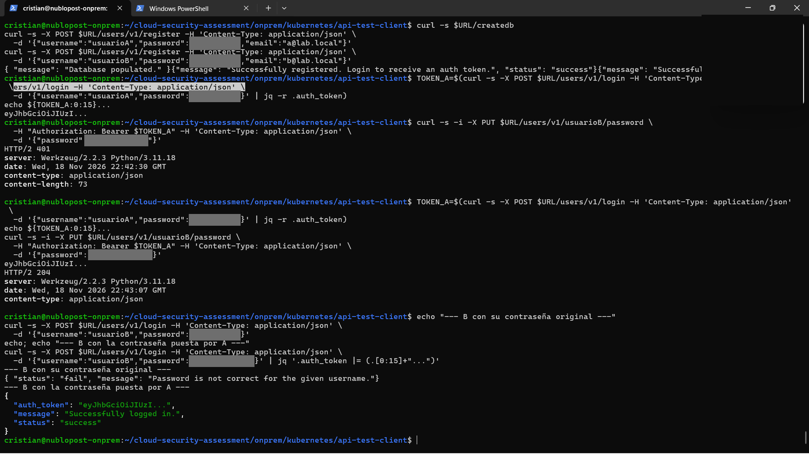

*Figura 25 · Cambio de la contraseña de B con el token de A (401 por caducidad, después 204) y toma de la cuenta. Contraseñas ocultas.*

**Impacto.** B pierde el acceso a su cuenta y el atacante entra en ella. Funciona con cualquier usuario cuyo nombre se conozca, incluido `admin`, cuyo nombre se obtiene con API-2.

**Por qué esta severidad.** Hace falta una cuenta propia (PR:L, registrarse es libre); afecta a la confidencialidad y a la integridad de cualquier cuenta, no a la disponibilidad del servicio.

**Remediación.**

1. Comparar el usuario del token con el de la ruta y devolver `403` si no coinciden (salvo administradores):

   ```python
   resp = token_validator(request.headers.get('Authorization'))
   if resp['sub'] != username:
       return Response(error_message_helper("Forbidden"), 403, mimetype="application/json")
   ```

2. Mejor aún: quitar el usuario de la ruta (`PUT /users/v1/me/password`) y pedir la contraseña actual para cambiarla.

La propia VAmPI incluye la versión corregida (variable `vulnerable=0`): actualiza la contraseña del usuario del token (`resp['sub']`) e ignora el de la URL.

#### API-2 · Inyección SQL con volcado de credenciales

| | |
|---|---|
| **Severidad** | Crítica · CVSS 3.1 **9.1** · `AV:N/AC:L/PR:N/UI:N/S:U/C:H/I:H/A:N` |
| **Dónde** | `GET /users/v1/{username}` (`models/user_model.py`, función `get_user`) |
| **Fase CEH** | 2 (indicio) → 3 |
| **Referencias** | CWE-89 · OWASP Top 10 2021 A03 (Injection) |
| **Detectado por** | Ninguna herramienta (Semgrep no la detecta). Solo prueba manual |
| **Re-test** | Pendiente; corrección propuesta abajo |

**Qué es.** Una inyección SQL ocurre cuando la aplicación pega el texto del usuario dentro de una consulta SQL. El atacante escribe SQL en lugar de un dato y cambia lo que hace la consulta.

**Dónde está.** La consulta que busca un usuario se construye con una cadena de formato: `f"SELECT * FROM users WHERE username = '{username}'"`. En la misma API, el registro de usuarios sí usa una consulta parametrizada.

**Cómo lo encontré.**

*Paso 1 · Indicio: una comilla rompe la consulta.* La comilla simple delimita textos en SQL. Si la entrada se pega en la consulta, una comilla de más la deja mal formada; con una consulta parametrizada, la API solo diría que el usuario no existe.

```bash
curl -s "$URL/users/v1/usuarioB'" | head -c 600
```

```
sqlalchemy.exc.OperationalError: (sqlite3.OperationalError) unrecognized token: "'usuarioB''"
[SQL: SELECT * FROM users WHERE username = 'usuarioB'']
```

La consulta se construye concatenando el texto. Además, el depurador entrega la consulta exacta y la estructura de la tabla: el atacante no tiene que adivinar nada.

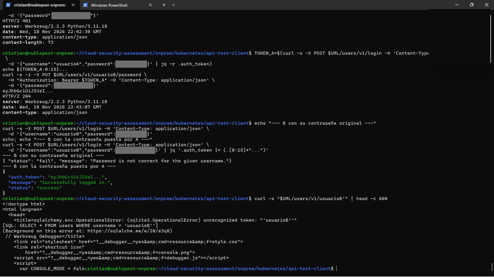

*Figura 26 · Error de SQL con una comilla, devuelto por el depurador de Werkzeug.*

*Paso 2 · Alterar la lógica de la consulta.* Pedí un usuario que no existe, añadiendo una condición que siempre es verdadera:

```bash
curl -s "$URL/users/v1/noexiste'%20OR%20'1'='1" | head -c 600
```

La consulta resultante es `SELECT * FROM users WHERE username = 'noexiste' OR '1'='1'`, y la API devuelve `{"username": "name1", "email": "mail1@mail.com"}`: un usuario que no he pedido.

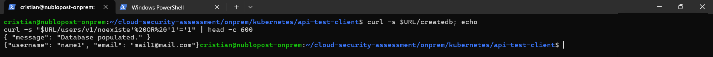

*Figura 27 · La API devuelve un usuario que no he pedido.*

*Paso 3 · Volcado de credenciales con `UNION`.* `UNION` añade una segunda consulta escrita por el atacante. La tabla tiene 5 columnas (las mostró el depurador) y la API devuelve la segunda como `username`. Para no exponer contraseñas en la evidencia, pedí solo sus 2 primeros caracteres:

```bash
P="x' UNION SELECT 1,group_concat(username||':'||substr(password,1,2)||'***',' | '),3,4,5 FROM users--"
curl -s "$URL/users/v1/$(jq -rn --arg p "$P" '$p|@uri')" | head -c 800
```

```
{"username": "name1:pa*** | name2:pa*** | admin:pa***", "email": "4"}
```

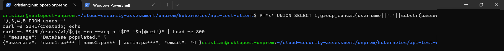

*Figura 28 · Todos los usuarios, incluido `admin`, con el principio de su contraseña en claro.*

**Impacto.**

- Lectura de toda la base de datos **sin autenticación**: todos los usuarios, incluido `admin`, y sus contraseñas.
- Las contraseñas se pueden leer porque están **guardadas en claro**, sin hash (sección 8).
- El campo `"email": "4"` confirma que el atacante controla por completo el resultado de la consulta.
- Encadenado con API-1: con el nombre `admin` se puede cambiar su contraseña. Con las contraseñas en claro ni siquiera hace falta: se entra directamente.

**Por qué esta severidad.** No requiere cuenta (PR:N) y da todas las credenciales de la API, es decir, el control de todas las cuentas.

**Remediación.**

1. Sustituir la consulta concatenada por la del ORM, que usa parámetros:

   ```python
   # Antes (vulnerable)
   user_query = f"SELECT * FROM users WHERE username = '{username}'"
   query = db.session.execute(text(user_query))

   # Después
   user = User.query.filter_by(username=username).first()
   # o, con SQL explícito, un parámetro enlazado:
   # db.session.execute(text("SELECT * FROM users WHERE username = :u"), {"u": username})
   ```

2. Validar el formato del nombre de usuario (por ejemplo, `^[A-Za-z0-9_.-]{3,30}$`).
3. Guardar las contraseñas con un hash lento (argon2id o bcrypt). La versión corregida de VAmPI (`vulnerable=0`) arregla la consulta, pero **no** esto.
4. Desactivar el modo depuración en producción (hallazgos complementarios).

---

## 7. Fases 4 y 5 · Mantenimiento del acceso y borrado de huellas

### 7.1 Mantenimiento del acceso

Con el rol Owner de AZ-3, un atacante no necesitaría repetir la cadena para volver a entrar. Estas serían sus opciones más probables:

- Creando una identidad propia (un *service principal* con su secreto) con un rol sobre la suscripción.
- Añadiendo una clave SSH propia a `authorized_keys` en la VM.
- Dejando un recurso propio (por ejemplo, una cuenta de almacenamiento) para sacar datos.

**Cómo se evita y se detecta:** alertas de Azure Monitor sobre nuevas asignaciones de rol y nuevas identidades; revisión periódica de identidades y credenciales; y acceso privilegiado *just-in-time* con Privileged Identity Management y caducidad de las asignaciones.

### 7.2 Borrado de huellas: qué queda registrado

En un pentest de caja blanca, enfoco esta fase como «qué deja el ataque y qué lo detectaría». No borré ningún registro. El Activity Log de la suscripción registró toda la escalada de AZ-3, con la identidad que originó cada acción:

| Operación | Iniciada por |
|---|---|
| `Write an Azure Automation runbook draft` | Identidad de la VM |
| `Publish an Azure Automation runbook draft` | Identidad de la VM |
| `Create an Azure Automation job` | Identidad de la VM |
| **`Create role assignment`** | **Identidad Owner de Automation** (ejecutada por el runbook) |
| `List Storage Account Keys` | Mi cuenta de auditor |

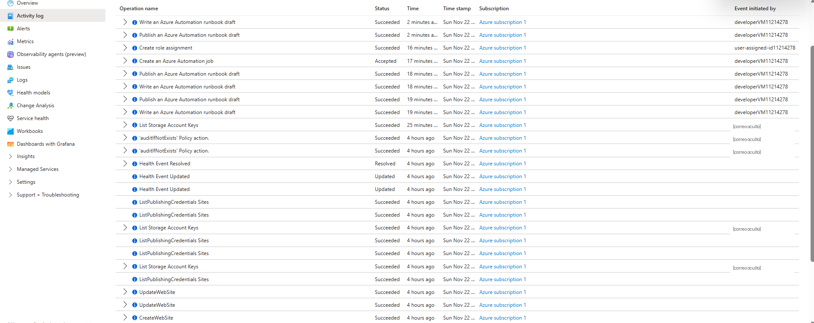

*Figura 29 · El Activity Log registra la edición del runbook y la asignación de rol, con la identidad que las originó.*

El ataque es totalmente trazable. El Activity Log no se puede borrar (Azure lo conserva 90 días) y su exportación se configura a nivel de suscripción, fuera del alcance de un Owner del grupo de recursos. Lo que faltaba en NubloPost no era el registro, sino **alertas**: nadie habría visto la escalada a tiempo.

**Recomendaciones de detección:**

- Alertas de Azure Monitor sobre `Microsoft.Authorization/roleAssignments/write` y sobre la escritura y publicación de runbooks.
- Exportar el Activity Log a Log Analytics o Microsoft Sentinel con una retención adecuada.
- Activar los planes de Microsoft Defender for Cloud para servidores y Storage, que detectan comportamientos anómalos.

---

## 8. Criptografía

### 8.1 Cifrado en tránsito (testssl.sh 3.2rc3)

| Aspecto | API de catálogo (Container Apps) | Aplicación web (Function Apps) |
|---|---|---|
| Protocolos | SSLv2, SSLv3, TLS 1.0 y 1.1 no ofrecidos; TLS 1.2 y 1.3 | Igual |
| Cifrados | Solo AEAD con *forward secrecy* (AES-GCM, ChaCha20-Poly1305, ECDHE); sin RC4, 3DES ni CBC | TLS 1.2 ofrece todavía cifrados CBC (aviso experimental de LUCKY13) |
| Certificado | RSA 2048 con SHA-384, emitido por Microsoft, válido | `*.azurewebsites.net`, compartido y renovado por la plataforma |
| Vulnerabilidades TLS | Heartbleed, POODLE, ROBOT, BEAST, SWEET32, FREAK, DROWN, LOGJAM y otras: no vulnerable | Heartbleed, ROBOT, POODLE, SWEET32, BEAST: no vulnerable |
| HSTS | No ofrecido | No ofrecido |
| Banner | `Werkzeug/2.2.3 Python/3.11.18` | `Kestrel` |
| Nota | **A (93/100)**, limitada por la falta de HSTS | **A**, limitada por la falta de HSTS |

No encontré algoritmos obsoletos (MD5, DES, 3DES, RC4) en el transporte. En los dos casos el TLS lo termina la plataforma de Azure, no la aplicación: es un ejemplo del modelo de responsabilidad compartida. Azure resuelve el cifrado del canal, pero lo que va dentro (cabeceras, autenticación, datos) es responsabilidad de NubloPost.

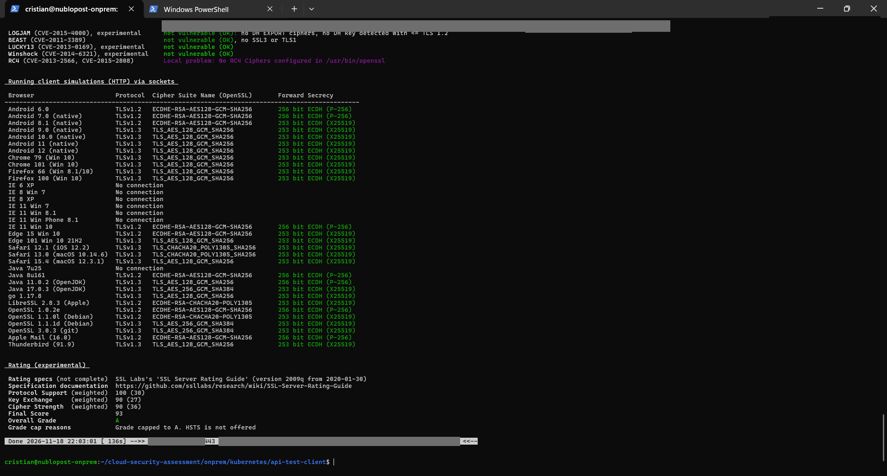

*Figura 30 · API de catálogo: clientes simulados y nota A, limitada por HSTS.*

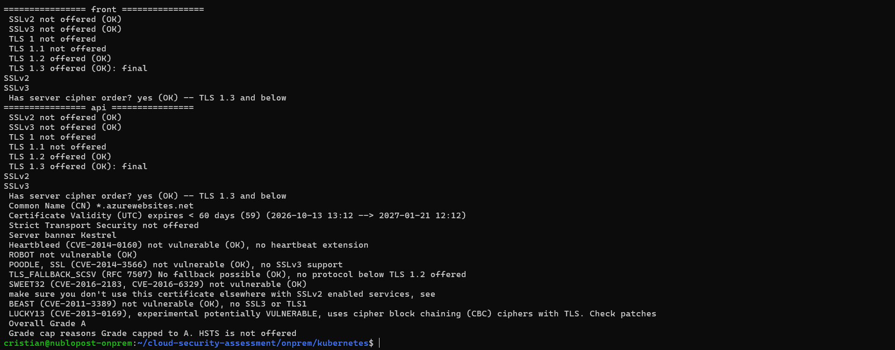

*Figura 31 · Function Apps: TLS 1.2 y 1.3, sin HSTS, banner Kestrel y aviso de LUCKY13 por los cifrados CBC.*

**Recomendaciones:** cabecera `Strict-Transport-Security`; en las Function Apps, `https_only = true` y `minimum_tls_version = "1.2"` en el Terraform; quitar los banners de servidor.

### 8.2 SSH de la VM (ssh-audit)

| Resultado | Algoritmos |
|---|---|
| **Fallo** | MAC `hmac-sha1-etm@openssh.com` (SHA-1, hash roto); intercambio de claves con curvas NIST (`ecdh-sha2-nistp256/384/521`); clave de host `ecdsa-sha2-nistp256` |
| **Aviso** | `diffie-hellman-group14-sha256` (módulo de 2048 bits, 112 bits de seguridad); MAC con etiqueta de 64 bits (`umac-64`); varios MAC en modo *encrypt-and-MAC* |
| **Correcto** | `curve25519-sha256`, `sntrup761x25519-sha512` (post-cuántico), `ssh-ed25519`, `chacha20-poly1305`, AES-GCM y `kex-strict` (contramedida de Terrapin, CVE-2023-48795) |

Es la configuración de serie de Ubuntu 22.04. Por sí sola no es grave; lo grave es que el puerto 22 esté abierto a todo Internet y acepte contraseña (sección 5.3).

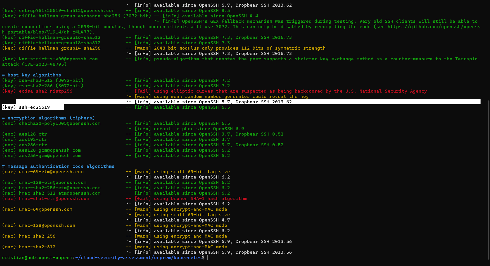

*Figura 32 · Algoritmos de cifrado y de MAC de la VM, con el MAC SHA-1 marcado como fallo.*

**Recomendación:** en `sshd_config`, limitar `KexAlgorithms` a curve25519 y sntrup761, `HostKeyAlgorithms` a ed25519 y `MACs` a los SHA-2 en modo *encrypt-then-MAC*; desactivar la contraseña; y, sobre todo, cerrar el 22 a Internet.

### 8.3 Almacenamiento de contraseñas

- **VAmPI: contraseñas en claro** (CWE-256). Lo demostré con API-2: la consulta devuelve las contraseñas tal cual. El login las compara como texto. La versión corregida de VAmPI tampoco aplica hash.
- **AzureGoat: bcrypt** con coste 10 (`bcrypt.gensalt(rounds=10)`). Es correcto, aunque OWASP recomienda hoy argon2id o un coste mayor.
- **Recomendación:** argon2id (o bcrypt con coste ≥ 12), con sal por usuario, siguiendo la guía de OWASP.

### 8.4 Firma de los tokens (JWT)

- **VAmPI** firma con **HS256** (clave simétrica) y los tokens duran unos 60 segundos, lo que limita el uso de uno robado. Pero la clave está **fija en el código**: `SECRET_KEY = 'random'` en `config.py` (CWE-321). Quien tenga el código, que es público, puede fabricar tokens de cualquier usuario. Lo detecta Semgrep; no lo exploté.
- **AzureGoat** firma también con **HS256**. Su secreto está en texto plano en el Terraform (`app_settings`) y en `local.settings.json`, que se despliega con el código y que robé con AZ-1.
- **Recomendación:** clave aleatoria de al menos 256 bits, fuera del código (Azure Key Vault) y rotada; o firma asimétrica (RS256 o ES256) con la clave privada en Key Vault.

### 8.5 Secretos y claves

- **Kubernetes:** los Secrets solo están **codificados en base64**, que no es cifrado (en K8S-1 los leí en claro con un token), y el clúster no los cifra en reposo en etcd (CWE-312). Recomendación: cifrado en reposo con un proveedor KMS y credenciales fuera del clúster (Key Vault con el Secrets Store CSI Driver).
- **Azure:** AzureGoat usa la **clave de la cuenta de Storage** como credencial principal (`CON_STR`) en lugar de una identidad administrada, y la cuenta admite autorización con clave compartida (Checkov CKV2_AZURE_40). Una sola fuga da control total del Storage (AZ-1).

### 8.6 Controles que funcionan

- El estado de Terraform se guarda en un Storage sin claves compartidas (solo Entra ID), con TLS 1.2 como mínimo y versionado.
- La protección de push de GitHub bloqueó la subida de una clave de Storage que venía en una línea comentada del código original de AzureGoat. La oculté antes de publicar, sin saltarme la protección.

---

## 9. Hallazgos complementarios

Fallos reales con menos impacto, o que no exploté, agrupados por área y ordenados por severidad. Llevan una valoración cualitativa; la columna «Origen» indica cómo encontré cada uno.

### 9.1 Azure (AzureGoat)

| Hallazgo | Severidad | Referencia | Recomendación | Origen |
|---|---|---|---|---|
| La VM acepta contraseña por SSH desde Internet, y la contraseña está escrita en el Terraform | Alta | CWE-798 · Checkov CKV_AZURE_1 y CKV_AZURE_10 | Solo claves, contraseña fuera del código y puerto 22 cerrado (AZ-2) | Nmap (no probé el login) |
| Function Apps sin HTTPS obligatorio, sin HSTS, con banner `Kestrel` y cifrados CBC en TLS 1.2 | Media | Checkov CKV_AZURE_70 | `https_only`, TLS mínimo 1.2 y HSTS | testssl.sh y Checkov |
| Contenedor de la aplicación con acceso público de nivel `blob`: el fichero robado con AZ-1 queda publicado | Media | Checkov CKV_AZURE_34 | Contenedor privado y URLs con SAS de corta duración | Prueba (AZ-1) |
| Cosmos DB con acceso de red público y autenticación por clave | Media | Checkov CKV_AZURE_101, CKV_AZURE_99 y CKV_AZURE_140 | Endpoint privado e identidades administradas | Checkov |
| Dependencias de la Function App con CVE conocidas: PyJWT 1.7.1 (CVE-2022-29217, confusión de algoritmos) y azure-storage-blob 12.12.0 (CVE-2022-30187) | Media | — | PyJWT ≥ 2.12 y azure-storage-blob ≥ 12.13 | Base de vulnerabilidades de PyPI |
| El código fuente de la web (React) tiene 94 dependencias vulnerables (8 críticas y 49 altas), casi todas de la cadena de compilación | Media | — | Actualizar las dependencias y vigilarlas con Dependabot | npm audit |
| Algoritmos SSH débiles (MAC SHA-1, curvas NIST, DH de 2048 bits) | Baja | — | Configuración de `sshd` (sección 8.2) | ssh-audit |
| Cuenta de Automation con acceso de red público | Baja | Checkov CKV2_AZURE_24 | Acceso privado | Checkov |

### 9.2 API de catálogo (VAmPI)

| Hallazgo | Severidad | Referencia | Recomendación | Origen |
|---|---|---|---|---|
| `/createdb` sin autenticación: cualquiera borra y recrea toda la base de datos | Alta | API5:2023 · CWE-306 | Eliminar el endpoint en producción o exigir rol de administrador | Prueba |
| Endpoint `/users/v1/_debug` sin autenticación que devuelve todos los usuarios con su contraseña | Alta | API3:2023 | Eliminar el endpoint en producción | Revisión de código; no probado |
| Clave de firma JWT fija en el código (`config.py`) | Alta | CWE-321 | Clave aleatoria en Key Vault (sección 8.4) | Semgrep; no explotado |
| Depurador de Werkzeug expuesto: consulta SQL, columnas, rutas y versiones en los errores, y consola protegida con PIN | Media | API8:2023 · CWE-489 · CWE-215 | `debug=False`, errores genéricos en JSON y servidor WSGI de producción | Prueba |
| Dependencias con CVE conocidas: Werkzeug 2.2.3 (entre ellas CVE-2024-34069, en el propio depurador), Flask 2.2.2 (CVE-2023-30861) y PyJWT 2.6.0 | Media | — | Werkzeug ≥ 3.1, Flask ≥ 3.1 y PyJWT ≥ 2.12 | Base de vulnerabilidades de PyPI |
| Servidor de desarrollo en producción, sin HSTS ni cabeceras de seguridad, y banner de versiones | Baja | API8:2023 | Gunicorn detrás del ingress, sin cabecera `Server` y con HSTS, `nosniff` y `Cache-Control: no-store` | testssl.sh |
| El contenedor de VAmPI se ejecuta como root y sin `HEALTHCHECK` | Baja | Checkov CKV_DOCKER_3 y CKV_DOCKER_2 | Usuario sin privilegios en el Dockerfile | Checkov |

### 9.3 Kubernetes on-premise

| Hallazgo | Severidad | Referencia | Recomendación | Origen |
|---|---|---|---|---|
| Contraseña de la cuenta de la API corta y predecible | Media | CWE-521 | Contraseña larga y aleatoria, rotada | Prueba (K8S-1) |
| Secret antiguo con credenciales obsoletas sin borrar | Baja | — | Borrar Secrets obsoletos y gestionarlos con `prune` | Prueba (K8S-1) |
| `api-test-client` recibe las credenciales como variables de entorno, con una imagen sin digest, sin sondas ni NetworkPolicy | Baja | Checkov CKV_K8S_35, CKV_K8S_43 y CKV2_K8S_6 | Secrets como ficheros, imagen por digest y NetworkPolicy | Checkov |

### 9.4 Plataforma y GitHub

| Hallazgo | Severidad | Referencia | Recomendación | Origen |
|---|---|---|---|---|
| El Storage del estado de Terraform admite acceso de red público (Cloud Shell no tiene IP fija), sin endpoint privado ni registros de lectura | Baja | Checkov CKV_AZURE_59, CKV2_AZURE_33 y CKV2_AZURE_21 | Endpoint privado si se despliega desde una red fija | Checkov (riesgo aceptado) |
| Secret Scanning no activado en el repositorio | Baja | — | Activar Secret Scanning y la protección de push para todo el repositorio | Mensaje de GitHub |

---

## 10. Matriz de cobertura: herramientas frente a prueba manual

Para cada hallazgo principal: ¿lo habría detectado una herramienta automática?

| Hallazgo | Lo detecta | Solo con la prueba manual |
|---|---|---|
| AZ-1 · SSRF → credenciales | Semgrep (`dynamic-urllib-use-detected` en `download_url`) | Que lee `local.settings.json` con todas las claves y el acceso a los datos |
| AZ-2 · Storage público → VM | Checkov (CKV_AZURE_34, CKV2_AZURE_47, CKV_AZURE_10, CKV_AZURE_1) y Gitleaks (las 8 claves privadas) | Que una de esas claves abre la VM desde Internet |
| AZ-3 · Escalada con Automation | Ninguna herramienta | Toda la cadena (abuso de permisos legítimos) |
| K8S-1 · RBAC → Secret → Azure | Kubescape (C-0035 y C-0015 sobre `superadmin`) | La cadena hacia Azure: qué contiene el Secret y que da acceso a un servicio cloud |
| K8S-2 · Contenedor privilegiado | Kubescape (C-0057, C-0038 y C-0048 sobre `system-monitor`) | El impacto real: root en el nodo y acceso a `ca.key` y `sa.key` |
| API-1 · BOLA | Ninguna herramienta (lógica de negocio) | Todo el hallazgo |
| API-2 · Inyección SQL | Ninguna herramienta | Todo el hallazgo; el indicio fue un error del depurador |

**Lectura.** Los escáneres detectan bien la **configuración insegura**: 4 de los 7 hallazgos tenían un aviso automático antes de desplegar o en el clúster (AZ-1, AZ-2, K8S-1 y K8S-2). Pero ninguno detecta la **lógica de negocio** (API-1), el **abuso de permisos legítimos** (AZ-3) ni el **impacto de encadenar fallos** entre entornos. La inyección SQL es un buen ejemplo de los límites del análisis estático: Semgrep no la encuentra porque la consulta se construye en una variable y el dato llega por el enrutado de connexion, no por `flask.request`, así que sus reglas no siguen el dato hasta la consulta.

---

## 11. Conclusiones

Este ha sido mi primer pentest y he aprendido muchísimo. Hasta ahora había visto cada parte por separado: en las prácticas que estoy haciendo en cloud trabajo con Azure y Terraform, y en el curso he aprendido la metodología y las herramientas de pentesting. Con este proyecto he podido juntar las dos cosas y ponerlas a prueba en un entorno completo, montado y atacado por mí.

Lo que más me ha sorprendido es cómo se encadenan los fallos. Cada uno por separado parece pequeño: una cuenta de servicio con demasiados permisos, un contenedor de Storage público o un runbook que se ejecuta como Owner. Pero juntos me han llevado desde un clúster on-premise hasta una API en Azure, y desde Internet hasta el control total de un grupo de recursos.

También me llevo que las herramientas automáticas no bastan. Los escáneres detectaron la mayoría de los problemas de configuración, pero ninguno vio el BOLA, la escalada con Automation ni el impacto real de cada fallo. Eso solo salió al probarlo a mano, entendiendo qué hace cada pieza.

Y lo que más me sirve para mi día a día en cloud: casi todo vuelve a lo mismo, mínimo privilegio y secretos bien guardados. Son cosas que veo en el trabajo, pero aquí he visto de primera mano qué pasa cuando se hacen mal.

Como siguiente paso, me gustaría aplicar las correcciones y repetir las pruebas para comprobar que de verdad cierran cada fallo.

---

## Anexo A · Entorno y versiones

| Componente | Versión |
|---|---|
| VM on-premise | Ubuntu Server 24.04 LTS (VirtualBox), configurada con Ansible |
| Clúster | kind v0.33.0 · Kubernetes v1.37.0 (`kindest/node:v1.37.0`) · containerd 2.3.4 · nodo Debian 13 |
| Kubernetes Goat | Commit `723a0db` |
| `api-test-client` | `python:3.13-alpine`, Pod Security Admission `restricted` |
| VAmPI | Commit `f16052d` en Azure Container Apps (swedencentral); Python 3.11.18, Werkzeug 2.2.3 |
| AzureGoat | Commit `b970459` con los cambios de `UPSTREAM.md`; provider `azurerm ~> 3.11`; Function Apps con runtime `~4` (Python 3.11 y Node 22); VM `Standard_D2s_v7` con Ubuntu 22.04 (Gen2) |
| Terraform | Raíces `platform` y `vampi` con provider `azurerm ~> 5.13`; todas aplicadas desde Azure Cloud Shell |
| Herramientas de prueba | curl, jq, kubectl v1.37.2, Azure CLI, Kubescape, Nmap 7.94SVN, ssh-audit, testssl.sh 3.2rc3 |
| Pipeline | Checkov 3.4.3, Semgrep 1.184.0, Trivy 0.76.2, Gitleaks 8.30.1 |

## Anexo B · Índice de evidencias

Capturas recortadas a la terminal, con URLs, IPs, identificadores, tokens y contraseñas ocultos. Están en `reports/final-report/evidencias/`; las originales las conservo fuera del control de versiones.

| Sección | Captura | Qué muestra |
|---|---|---|
| 4.3 | `azure/0.1-inventario.png` | Inventario de AzureGoat |
| 5.2 | `kubernetes/3.2-kubescape-resumen.png` | Resultado de los 5 controles de Kubescape |
| 5.2 | `kubernetes/3.3-kubescape-detecta-superadmin-system-monitor.png` | Los dos recursos de los hallazgos señalados |
| 5.3 | `azure/0.2-nmap-ssh-audit-1.png` | Nmap y comienzo de ssh-audit |
| 5.3 | `azure/0.3-ssh-acepta-password.png` | Métodos de autenticación SSH |
| AZ-1 | `azure/1.1-ssrf-indicio-codigo.png` | `download_url` sin validación |
| AZ-1 | `azure/1.2-ssrf-etc-passwd.png` | Lectura de `/etc/passwd` |
| AZ-1 | `azure/1.3-ssrf-local-settings-credenciales.png` | Secretos de `local.settings.json` (ocultos) |
| AZ-1 | `azure/1.4-storage-con-cadena-robada.png` | Storage con la clave robada |
| AZ-2 | `azure/2.1-dev-container-claves-ssh.png` | Listado anónimo del contenedor `dev` |
| AZ-2 | `azure/2.2-config-ssh-justin-vm.png` | `config.txt` y `deploy_node.sh` |
| AZ-2 | `azure/2.3-ssh-justin-acceso-vm.png` | Shell en la VM como `justin` |
| AZ-3 | `azure/3.1-login-identidad-gestionada-vm.png` | Login con la identidad de la VM |
| AZ-3 | `azure/3.2-rol-contributor-identidad-vm.png` | Rol Contributor de la VM |
| AZ-3 | `azure/3.3-automation-identidad-owner.png` | Identidad Owner de Automation |
| AZ-3 | `azure/3.4-runbook-inyectado-workflow.png` | Runbook original y sustituido |
| AZ-3 | `azure/3.5-escalada-owner-antes-despues.png` | Job y roles después de la escalada |
| AZ-3 | `azure/3.5a-job-completado.png` | Estados del job |
| AZ-3 | `azure/3.5b-escalada-owner.png` | Asignación de Owner creada |
| AZ-3 | `azure/3.6-limpieza-restaurado.png` | Runbook restaurado y rol retirado |
| 7.2 | `azure/5.1-activity-log-cadena-ataque.png` | Activity Log de la escalada |
| 8.1 | `azure/0.4-testssl-resumen.png` | TLS de las Function Apps |
| 8.2 | `azure/0.2-ssh-audit-2.png` | Algoritmos SSH de la VM |
| 6.2 | `kubernetes/0.2-estado-cluster.png` | Estado del clúster antes de las pruebas |
| K8S-1 | `kubernetes/1.1-rbac-superadmin-cluster-admin.png` | Binding de `cluster-admin` y permisos `*.*` |
| K8S-1 | `kubernetes/1.2-token-sa-lista-secrets.png` | Lista de Secrets con solo el token de la cuenta |
| K8S-1 | `kubernetes/1.3-secret-descodificado.png` | Credenciales de la API en el Secret |
| K8S-1 | `kubernetes/1.4a-ingress-ip-403.png` | El ingress rechaza una IP no autorizada |
| K8S-1 | `kubernetes/1.4-login-api-azure-credenciales-robadas.png` | Login en la API con las credenciales robadas |
| K8S-2 | `kubernetes/2.1-system-monitor-privileged-hostpath.png` | Especificación privilegiada del pod |
| K8S-2 | `kubernetes/2.2-escape-chroot-nodo.png` | Escape al nodo con `chroot` |
| 8.1 | `api/0.2-testssl-1-protocolos-cifrados.png` | Protocolos y cifrados de la API |
| 8.1 | `api/0.2-testssl-2-certificado-cabeceras.png` | Certificado y cabeceras de la API |
| 8.1 | `api/0.2-testssl-3-simulacion-nota.png` | Simulación de clientes y nota |
| API-1 | `api/1.3-bola-ataque-204.png` | Cambio de la contraseña de B con el token de A |
| API-1 | `api/1.4-bola-impacto-toma-cuenta.png` | Toma de la cuenta de B |
| API-2 | `api/2.1-sqli-indicio-comilla.png` | Error SQL con una comilla |
| API-2 | `api/2.2-sqli-or-1-1-usuario-ajeno.png` | Usuario ajeno con `OR '1'='1'` |
| API-2 | `api/2.3-sqli-union-volcado-credenciales.png` | Volcado de usuarios con `UNION` |

## Anexo C · Repositorio

Todo el laboratorio está definido como código en el repositorio público del proyecto:

**https://github.com/Pentesting-Nublopost-onprem/cloud-security-assessment**

| Carpeta | Contenido |
|---|---|
| `architecture/` | Arquitectura, diseño de red y alcance con las reglas de compromiso |
| `terraform/platform/` | Estado remoto de Terraform, grupos de recursos y presupuesto |
| `terraform/azuregoat/` | AzureGoat con sus cambios de despliegue (`UPSTREAM.md`) |
| `terraform/vampi/` | VAmPI en Container Apps con acceso solo desde la IP autorizada |
| `onprem/ansible/` | Configuración del servidor Ubuntu (Docker, kind, kubectl, Helm) |
| `onprem/kubernetes/` | Clúster kind, Kubernetes Goat y el cliente `api-test-client` |
| `applications/vampi/` | Código de VAmPI del que se construye la imagen |
| `.github/workflows/` | `build-vampi` (imagen de la API) y `security-scan` (escáneres) |
| `security/` | Configuración de Checkov y Gitleaks |
| `pentest/methodology.md` | Metodología de las pruebas |
| `reports/final-report/` | Este informe, su versión PDF, las evidencias publicadas y el script que genera el PDF (`build/`) |

## Bibliografía

**Metodología y puntuación**

- EC-Council. *Certified Ethical Hacker (CEH)*. https://www.eccouncil.org/train-certify/certified-ethical-hacker-ceh/
- FIRST. *Common Vulnerability Scoring System v3.1: Specification Document*. https://www.first.org/cvss/v3.1/specification-document
- MITRE. *ATT&CK*: T1098, T1530, T1552.001, T1552.004, T1552.007 y T1611. https://attack.mitre.org/
- MITRE. *CWE*: 89, 215, 250, 256, 269, 306, 312, 321, 489, 521, 522, 552, 639, 798 y 918. https://cwe.mitre.org/

**Aplicaciones y API**

- OWASP. *API Security Top 10 (2023)*. https://owasp.org/API-Security/editions/2023/en/0x11-t10/
- OWASP. *Top 10 (2021): A03 Injection*. https://owasp.org/Top10/A03_2021-Injection/
- OWASP Cheat Sheet Series. *Server Side Request Forgery Prevention*. https://cheatsheetseries.owasp.org/cheatsheets/Server_Side_Request_Forgery_Prevention_Cheat_Sheet.html
- OWASP Cheat Sheet Series. *SQL Injection Prevention*. https://cheatsheetseries.owasp.org/cheatsheets/SQL_Injection_Prevention_Cheat_Sheet.html
- OWASP Cheat Sheet Series. *Password Storage*. https://cheatsheetseries.owasp.org/cheatsheets/Password_Storage_Cheat_Sheet.html
- OWASP Cheat Sheet Series. *HTTP Headers*. https://cheatsheetseries.owasp.org/cheatsheets/HTTP_Headers_Cheat_Sheet.html
- IETF. *RFC 8725: JSON Web Token Best Current Practices*. https://www.rfc-editor.org/rfc/rfc8725

**Azure**

- Microsoft. *Shared responsibility in the cloud*. https://learn.microsoft.com/azure/security/fundamentals/shared-responsibility
- Microsoft. *Prevent anonymous read access to containers and blobs*. https://learn.microsoft.com/azure/storage/blobs/anonymous-read-access-prevent
- Microsoft. *Use Key Vault references as app settings in Azure App Service and Azure Functions*. https://learn.microsoft.com/azure/app-service/app-service-key-vault-references
- Microsoft. *Using a managed identity with Azure Automation*. https://learn.microsoft.com/azure/automation/enable-managed-identity-for-automation
- Microsoft. *Azure Bastion*. https://learn.microsoft.com/azure/bastion/bastion-overview

**Kubernetes**

- Kubernetes. *Role Based Access Control Good Practices*. https://kubernetes.io/docs/concepts/security/rbac-good-practices/
- Kubernetes. *Pod Security Standards*. https://kubernetes.io/docs/concepts/security/pod-security-standards/
- Kubernetes. *Good practices for Kubernetes Secrets*. https://kubernetes.io/docs/concepts/security/secrets-good-practices/
- Kubernetes. *Encrypting Confidential Data at Rest*. https://kubernetes.io/docs/tasks/administer-cluster/encrypt-data/
- Microsoft. *Azure Key Vault provider for Secrets Store CSI Driver*. https://learn.microsoft.com/azure/aks/csi-secrets-store-driver

**Laboratorios y herramientas**

- INE. *AzureGoat*. https://github.com/ine-labs/AzureGoat
- M. Akula. *Kubernetes Goat*. https://madhuakula.com/kubernetes-goat/
- erev0s. *VAmPI: Vulnerable REST API*. https://github.com/erev0s/VAmPI
- Kubescape. https://kubescape.io/
- Checkov. https://www.checkov.io/
- Semgrep. https://semgrep.dev/
- Gitleaks. https://github.com/gitleaks/gitleaks
- Trivy. https://trivy.dev/
- Nmap. https://nmap.org/
- ssh-audit. https://github.com/jtesta/ssh-audit
- testssl.sh. https://testssl.sh/
