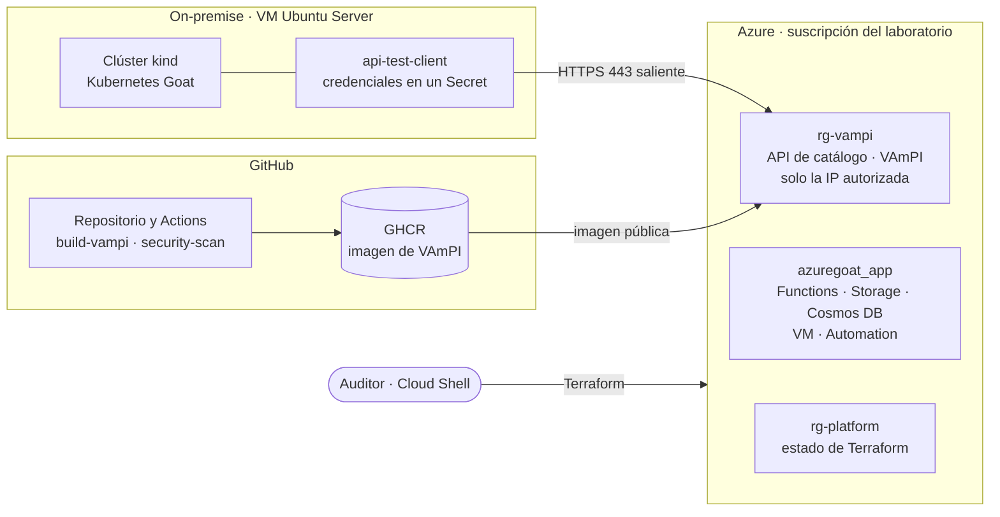
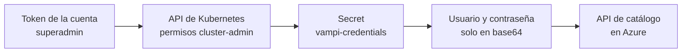

# Informe de pentest de caja blanca · NubloPost, S.L.

**Cloud Security Assessment: White-Box Pentesting & CI/CD Security**

| | |
|---|---|
| **Autor** | Cristian Rodríguez |
| **Proyecto** | Proyecto final de Pentesting (bootcamp de ciberseguridad) |
| **Cliente** | NubloPost, S.L. (empresa ficticia) |
| **Pruebas** | 18–22/11/2026 · Azure: pendiente |
| **Versión** | 0.1 · borrador del 22/11/2026 |
| **Confidencialidad** | Laboratorio formativo. URLs, IPs, tokens y contraseñas aparecen ocultos |

> **Estado del borrador.** Están completas las sesiones de Kubernetes y de la API (4 de los 7 hallazgos principales). La sesión de Azure (AzureGoat) se añadirá al terminarla. Lo pendiente está marcado con ⏳.

## Índice

1. Introducción y alcance
2. Resumen ejecutivo
3. Metodología
4. Fase 1 · Reconocimiento: arquitectura e inventario
5. Fase 2 · Escaneo y enumeración
6. Fase 3 · Obtención de acceso: hallazgos principales
7. Fases 4 y 5 · Mantenimiento del acceso y borrado de huellas ⏳
8. Criptografía
9. Hallazgos complementarios
10. Matriz de cobertura: herramientas frente a prueba manual
11. Conclusiones ⏳
- Anexo A · Entorno y versiones
- Anexo B · Índice de evidencias
- Bibliografía

---

## 1. Introducción y alcance

### 1.1 Objetivo

Simular un pentest profesional de caja blanca sobre la infraestructura de NubloPost, S.L., una empresa con una parte on-premise (Kubernetes), servicios en Azure y el código en GitHub. Las preguntas que responde el informe son:

- ¿Puede un atacante tomar cuentas de usuario o de administrador?
- ¿Hasta dónde puede escalar privilegios desde un punto de apoyo pequeño?
- ¿Un fallo en el servidor on-premise da acceso a la nube?
- ¿Qué detectan las herramientas automáticas y qué solo aparece en la prueba manual?

### 1.2 Escenario: NubloPost, S.L.

NubloPost es una startup de unos 35 empleados con una plataforma de publicación de contenidos para creadores. No tiene equipo de seguridad: la infraestructura la mantienen 4 desarrolladores con perfil DevOps, que priorizan la velocidad de desarrollo. La aplicación y la API de catálogo están en Azure; un pequeño servidor on-premise con Kubernetes ejecuta servicios internos que consumen esa API; el código y la automatización están en GitHub.

### 1.3 Cambio respecto a la práctica 14 (Active Directory)

El proyecto del curso parte de una red empresarial con Active Directory. Este trabajo la sustituye por un entorno **híbrido on-premise + Azure** por dos motivos:

1. **Perfil profesional:** el autor trabaja en seguridad cloud (Azure, Terraform y Kubernetes), y es el entorno que quiere poder auditar.
2. **Dónde está hoy la identidad:** en muchas empresas, los privilegios ya no viven solo en un Active Directory local, sino en Entra ID, en identidades administradas y en el RBAC de Azure y de Kubernetes.

Los conceptos de un pentest de Active Directory tienen su equivalente en este laboratorio:

| En Active Directory | En este laboratorio |
|---|---|
| Controlador de dominio expuesto | Function App pública de AzureGoat (perímetro) |
| Grupos y ACL | RBAC de Azure y de Kubernetes |
| Cuenta de servicio con demasiados privilegios | Identidad administrada o ServiceAccount con `cluster-admin` |
| Escalada abusando de un servicio con más privilegios | Escalada de Contributor a Owner a través de Azure Automation; escape de contenedor al nodo |
| Movimiento lateral por la red | Pivote on-premise → Azure con credenciales robadas |
| Credenciales en scripts o en SYSVOL | Credenciales en Secrets de Kubernetes, ficheros desplegados y código |

**Para calibrar la dificultad:** los tres objetivos son laboratorios vulnerables públicos (AzureGoat de INE, Kubernetes Goat y VAmPI), así que sus vulnerabilidades son conocidas. El trabajo propio está en:

- Desplegarlos en 2026: AzureGoat necesitó varios arreglos para funcionar (runtimes retirados, imágenes y tamaños de VM no disponibles); están documentados en `terraform/azuregoat/UPSTREAM.md`.
- Integrarlos en una arquitectura única, definida como código (Terraform y Ansible), con un pipeline de escáneres de seguridad.
- La cadena on-premise → Azure del hallazgo K8S-1, que no forma parte de ningún laboratorio: la diseñó el autor al conectar el clúster con la API.
- La comparación entre lo que detectan los escáneres y lo que solo aparece en la prueba manual.

### 1.4 Alcance

| Dentro del alcance | Fuera del alcance |
|---|---|
| Azure, grupo `azuregoat_app`: AzureGoat (Function Apps, Storage, Cosmos DB, VM, Automation, identidades y RBAC) | Recursos de terceros, corporativos o de cualquier empleador |
| Azure, grupo `rg-vampi`: API de catálogo (VAmPI) en Container Apps | Infraestructura de Microsoft y de GitHub |
| Azure, grupo `rg-platform`: estado de Terraform y presupuesto (**solo revisión**, sin explotación) | Denegación de servicio y pruebas destructivas |
| On-premise: VM Ubuntu Server, clúster kind, Kubernetes Goat y el cliente `api-test-client` | Ingeniería social |
| GitHub: repositorio `cloud-security-assessment` y sus workflows (revisión de configuración) | Escenarios de CI/CD vulnerables (aplazados por tiempo) |
| Código: AzureGoat, VAmPI, Terraform y manifiestos de Kubernetes | Persistencia fuera del laboratorio |

### 1.5 Enfoque y reglas de compromiso

- **Caja blanca con brecha asumida:** el auditor puede leer el repositorio (Terraform, código y workflows) y tiene una identidad de solo lectura sobre el laboratorio de Azure. En Kubernetes se revisa la configuración como administrador, pero los ataques se hacen con la identidad que tendría un atacante (por ejemplo, el token de una cuenta de servicio).
- **Laboratorio propio:** suscripción personal de Azure, VM en el portátil del autor y repositorios propios. Los recursos de Azure solo están encendidos durante las sesiones.
- **Exposición mínima:** la API solo acepta conexiones desde la IP del auditor; el API server de Kubernetes solo escucha en `127.0.0.1`.
- **Sin daño:** sin denegación de servicio; los cambios y la persistencia se documentan y se revierten en la misma sesión; los registros de auditoría no se borran.
- **Evidencias:** se guardan fuera del control de versiones y se publican con URLs, IPs, tokens y contraseñas ocultos.

Reglas completas: [`architecture/scope.md`](../../architecture/scope.md).

---

## 2. Resumen ejecutivo

Entre el 18 y el 22 de noviembre de 2026 se evaluó la infraestructura de NubloPost con una metodología de caja blanca. Hasta ahora se han probado el clúster Kubernetes on-premise y la API de catálogo en Azure; la aplicación web en Azure (AzureGoat) se evalúa en la última sesión.

**Resultado provisional: 4 vulnerabilidades principales demostradas, 3 críticas y 1 alta**, además de 9 hallazgos complementarios.

| ID | Vulnerabilidad | Severidad |
|---|---|---|
| K8S-1 | Una cuenta de servicio con permisos de administrador da las credenciales de la API y, con ellas, acceso a Azure | **Crítica** (9.9) |
| K8S-2 | Un contenedor privilegiado da el control del nodo y de todo el clúster | **Crítica** (9.9) |
| API-2 | Inyección SQL: cualquiera, sin iniciar sesión, obtiene todos los usuarios y sus contraseñas | **Crítica** (9.1) |
| API-1 | Cualquier usuario registrado cambia la contraseña de otro y le quita la cuenta | **Alta** (8.1) |
| AZ-1 a AZ-3 | Aplicación web en Azure ⏳ | ⏳ |

**Lo más grave, en pocas palabras:**

1. **Del servidor interno a la nube.** Un fallo de permisos en el Kubernetes on-premise permite leer las credenciales que el servicio interno usa para la API de Azure, y entrar en ella. Un error en un servidor «interno» compromete un servicio cloud.
2. **Un contenedor controla todo el clúster.** Desde un contenedor mal configurado se obtiene root en el nodo principal y las claves de la autoridad de certificación del clúster: control permanente de Kubernetes.
3. **La API expone todas las cuentas.** Sin iniciar sesión se pueden leer los usuarios y las contraseñas, guardadas sin cifrar, incluida la del administrador. Además, cualquier usuario puede cambiar la contraseña de otro.

**Lo que funciona bien:** el cifrado en tránsito de la API (nota A, gestionado por Azure); la restricción por IP de la API, que impidió usar las credenciales robadas desde fuera de la red autorizada; la protección de push de GitHub, que bloqueó la subida de una clave; y que un escáner gratuito (Kubescape) detecta la configuración insegura del clúster.

**Prioridades de corrección:**

| Prioridad | Acción | Hallazgos | Esfuerzo |
|---|---|---|---|
| 1 | Consultas SQL parametrizadas, contraseñas con hash (bcrypt o argon2) y modo depuración desactivado | API-2 y complementarios | Bajo |
| 2 | Comprobar en la API que el usuario del token es el dueño del recurso | API-1 | Bajo |
| 3 | Quitar `cluster-admin` a la cuenta `superadmin`, llevar las credenciales a Azure Key Vault y cambiar la contraseña expuesta | K8S-1 | Medio |
| 4 | Prohibir contenedores privilegiados con Pod Security Admission `restricted` | K8S-2 | Bajo |
| 5 | Ejecutar Kubescape, Checkov y Semgrep como comprobaciones obligatorias del pipeline | Prevención | Medio |
| ⏳ | Acciones de Azure | AZ-1 a AZ-3 | ⏳ |

---

## 3. Metodología

Se siguen las cinco fases de la metodología CEH (EC-Council), adaptadas a caja blanca:

| Fase CEH | Qué se hizo | Herramientas | Sección |
|---|---|---|---|
| 1 · Reconocimiento | Inventario de activos y arquitectura a partir del repositorio, de Azure y del clúster | Lectura del código, Azure CLI, kubectl | 4 |
| 2 · Escaneo y enumeración | Escáneres del pipeline, Kubescape sobre el clúster y análisis de TLS | Checkov, Trivy, Semgrep, Gitleaks, Kubescape, testssl.sh (Nmap y ssh-audit en Azure ⏳) | 5 |
| 3 · Obtención de acceso | Prueba de concepto de cada hallazgo principal, incluida la escalada | curl, jq, kubectl, Azure CLI, ssh | 6 |
| 4 · Mantenimiento del acceso | Una demostración de persistencia en Azure, revertida | Azure CLI ⏳ | 7 |
| 5 · Borrado de huellas | Qué deja el ataque en el Activity Log y en Defender for Cloud. No se borran registros | Activity Log, Defender for Cloud ⏳ | 7 |

**Sesiones de prueba:**

| Sesión | Fechas | Objetivo | Estado |
|---|---|---|---|
| 1 · Azure (AzureGoat) | 22/11/2026 → | Aplicación web, Storage, VM e identidades | ⏳ |
| 2 · Kubernetes on-premise | 19 y 22/11/2026 | Clúster kind con Kubernetes Goat y el cliente de la API | ✅ |
| 3 · API (VAmPI) | 18–19/11/2026 | API de catálogo en Container Apps (OWASP API Security Top 10) | ✅ |

**Criterios:**

- **Severidad:** CVSS v3.1 (vector y puntuación base). Crítica ≥ 9.0 · Alta 7.0–8.9 · Media 4.0–6.9 · Baja < 4.0. Los hallazgos complementarios llevan una valoración cualitativa.
- **Formato de cada hallazgo:** qué es, dónde está, cómo se encontró (paso a paso), impacto y remediación.
- **Re-test:** por tiempo, las correcciones no se despliegan. Cada hallazgo incluye la corrección exacta y queda marcado como «Re-test: no realizado».
- **Evidencias:** salidas de terminal en texto y capturas de los momentos clave (Anexo B).

---

## 4. Fase 1 · Reconocimiento: arquitectura e inventario

En caja blanca, el reconocimiento empieza por el propio repositorio: el Terraform describe qué hay en Azure, los manifiestos describen el clúster y el código muestra cómo trata cada aplicación los datos. Después se contrasta con lo desplegado (Azure CLI y `kubectl`).

### 4.1 Arquitectura



| Bloque | Componente | Versión o detalle |
|---|---|---|
| On-premise | VM Ubuntu Server (VirtualBox), configurada con Ansible | Ubuntu 24.04 LTS |
| On-premise | Clúster kind de un solo nodo (plano de control y cargas en el mismo nodo) | Kubernetes v1.37.0 · containerd 2.3.4 · nodo Debian 13 |
| On-premise | Kubernetes Goat (escenarios vulnerables) | Commit `723a0db` |
| On-premise | `api-test-client`: servicio interno que llama a la API de Azure | Credenciales en un Secret del namespace `nublopost-client` |
| Azure | API de catálogo: VAmPI en Container Apps, solo HTTPS y solo la IP del auditor | Commit `f16052d` · Python 3.11.18 · Werkzeug 2.2.3 |
| Azure | Aplicación web: AzureGoat | Commit `b970459` con arreglos de despliegue ⏳ |
| Azure | Plataforma: estado de Terraform (solo Entra ID, sin claves) y presupuesto | Fuera de la explotación |
| GitHub | Actions: imagen de VAmPI y escáneres de seguridad | GitHub no tiene credenciales de Azure |

### 4.2 Fronteras de confianza

| # | Frontera | Qué se evalúa |
|---|---|---|
| F1 | Portátil ↔ VM | Bastionado del servidor (SSH, Docker) |
| F2 | Contenedores ↔ nodo de Kubernetes | RBAC, Secrets, contenedores privilegiados y escapes (K8S-1, K8S-2) |
| F3 | On-premise ↔ Azure | La cadena a través del Secret de la API (K8S-1) |
| F4 | Internet ↔ servicios de Azure | Exposición, almacenamiento e identidades (API-1, API-2, AZ-1 a AZ-3) |
| F5 | GitHub → Azure | Permisos de los workflows, secretos en el repositorio e imagen de GHCR |
| F6 | Estado de Terraform | Secretos en el estado y acceso al Storage |

### 4.3 Qué marcó el reconocimiento

La revisión del repositorio y de lo desplegado señaló estas zonas para las fases siguientes:

- **Kubernetes:** una ServiceAccount de `kube-system` ligada a `cluster-admin`, un Deployment con `privileged: true` y el disco del nodo montado, y unas credenciales de un servicio de Azure guardadas como Secret.
- **API:** VAmPI arranca Flask en modo depuración (`app.py`, `debug=True`) con el servidor de desarrollo, firma los tokens con una clave fija en el código y guarda las contraseñas sin hash.
- **Azure:** ⏳ contenedores de Storage, identidad de la VM y cuenta de Automation.

---

## 5. Fase 2 · Escaneo y enumeración

### 5.1 Pipeline de escáneres (`security-scan`)

En cada subida a GitHub, el workflow `security-scan` ejecuta cuatro escáneres sobre el código del repositorio, sin desplegar nada:

| Herramienta | Qué revisa |
|---|---|
| Checkov 3.4.3 | Terraform, manifiestos de Kubernetes, Dockerfile, Ansible y workflows |
| Semgrep 1.184.0 | Código de VAmPI, de las Functions de AzureGoat y del cliente on-premise |
| Trivy 0.76.2 | Dependencias con vulnerabilidades conocidas e imagen de VAmPI |
| Gitleaks 8.30.1 | Secretos en todo el historial de Git |

Los resultados se publican en la pestaña *Security → Code scanning* del repositorio. ⏳ Su análisis se añadirá a las secciones 9 y 10.

### 5.2 Kubescape sobre el clúster

Kubescape (CNCF) revisa los recursos desplegados contra controles de NSA/CISA y MITRE ATT&CK. Se lanzaron los cinco controles relacionados con los hallazgos de Kubernetes:

```bash
kubescape scan control C-0035,C-0015,C-0057,C-0038,C-0048
```

| Severidad | Control | Recursos que fallan | Hallazgo |
|---|---|---|---|
| Alta | C-0015 · List Kubernetes secrets | 10 de 84 | K8S-1 |
| Media | C-0035 · Administrative Roles | 3 de 84 | K8S-1 |
| Alta | C-0057 · Privileged container | 3 de 20 | K8S-2 |
| Alta | C-0038 · Host PID/IPC privileges | 1 de 20 | K8S-2 |
| Alta | C-0048 · HostPath mount | 8 de 20 | K8S-2 |

Los 5 controles fallan (cumplimiento global del 84,9 %). En detalle, Kubescape señala exactamente los dos recursos de los hallazgos: la ServiceAccount `superadmin` (C-0035 y C-0015) y el Deployment `system-monitor-deployment` (C-0057, C-0038 y C-0048).

> **Evidencia:** `3.2-kubescape-resumen.png`, `3.3-kubescape-detecta-superadmin-system-monitor.png`.

### 5.3 TLS de la API

`testssl.sh` sobre el endpoint de la API: solo TLS 1.2 y 1.3, cifrados robustos y nota A. Detalle en la sección 8.

### 5.4 Azure ⏳

Nmap y ssh-audit sobre la VM de AzureGoat y testssl.sh sobre las Function Apps.

---

## 6. Fase 3 · Obtención de acceso: hallazgos principales

| ID | Vulnerabilidad | Severidad | CVSS 3.1 |
|---|---|---|---|
| AZ-1 | SSRF en la Function App → credenciales de la aplicación | ⏳ | ⏳ |
| AZ-2 | Contenedor de Storage público → clave SSH → acceso a la VM | ⏳ | ⏳ |
| AZ-3 | Escalada de Contributor a Owner a través de Azure Automation | ⏳ | ⏳ |
| K8S-1 | RBAC excesivo → Secret → acceso a la API de Azure | Crítica | 9.9 |
| K8S-2 | Contenedor privilegiado → nodo del clúster | Crítica | 9.9 |
| API-1 | Autorización rota a nivel de objeto (BOLA): cambio de la contraseña de otro usuario | Alta | 8.1 |
| API-2 | Inyección SQL con volcado de credenciales | Crítica | 9.1 |

### 6.1 Azure (AzureGoat) ⏳

Se completará al terminar la Sesión 1 con los hallazgos AZ-1, AZ-2 y AZ-3.

### 6.2 Kubernetes on-premise

Antes de empezar se hizo un snapshot de la VM: el hallazgo K8S-2 da privilegios sobre el nodo y la frontera real del laboratorio es la VM. El clúster estaba sano: un nodo `Ready` (Kubernetes v1.37.0), los escenarios de Kubernetes Goat y el pod `api-test-client` en ejecución (`0.2-estado-cluster.png`).

#### K8S-1 · RBAC excesivo → Secret → acceso a la API de Azure

| | |
|---|---|
| **Severidad** | Crítica · CVSS 3.1 **9.9** · `AV:N/AC:L/PR:L/UI:N/S:C/C:H/I:H/A:H` |
| **Dónde** | Clúster kind: ServiceAccount `superadmin` (namespace `kube-system`) ligada a `cluster-admin`; Secret `vampi-credentials-*` (namespace `nublopost-client`); API de catálogo en Azure |
| **Fase CEH** | 1–2 (revisión del RBAC) → 3 |
| **Referencias** | CWE-269 (gestión incorrecta de privilegios) · CWE-522 (credenciales mal protegidas) · MITRE ATT&CK T1552.007 |
| **Detectado por** | Kubescape (C-0035, C-0015) y revisión manual. La cadena hacia Azure, solo con la prueba |
| **Re-test** | No realizado por tiempo; corrección propuesta abajo |

**Qué es.** El RBAC de Kubernetes decide qué puede hacer cada identidad. `cluster-admin` es el equivalente a root: todos los permisos sobre todos los recursos. Si una cuenta de servicio lo tiene, cualquiera que consiga su token controla el clúster, incluidos los Secrets, que guardan credenciales.

**Dónde está.** El ClusterRoleBinding `superadmin` da `cluster-admin` a la ServiceAccount `superadmin` de `kube-system` (escenario `insecure-rbac` de Kubernetes Goat). En el mismo clúster, el servicio interno `api-test-client` guarda en un Secret el usuario y la contraseña con los que se conecta a la API de catálogo en Azure.



**Cómo se encontró.**

*Paso 1 · Indicio: revisión del RBAC.* En caja blanca, lo primero es ver quién puede hacer qué.

```bash
kubectl get clusterrolebinding superadmin -o yaml
kubectl auth can-i --list --as=system:serviceaccount:kube-system:superadmin | head -15
```

- El binding enlaza el ClusterRole `cluster-admin` con la ServiceAccount `superadmin` de `kube-system`. Se creó el 10/11/2026 con `kubectl apply`: es configuración declarada a propósito, visible en los manifiestos.
- `auth can-i --list` devuelve `*.*  []  []  [*]`: todos los verbos sobre todos los recursos.

> **Evidencia:** `1.1-rbac-superadmin-cluster-admin.png`.

*Paso 2 · Con solo el token de la cuenta, listar los Secrets.* Un atacante real no tiene el kubeconfig de administrador, sino el token de una cuenta de servicio (montado en un pod comprometido o filtrado en un log). Para simular ese robo se genera un token de `superadmin` y se usa `curl` contra la API de Kubernetes **solo con ese token**, sin el certificado de administrador:

```bash
TOKEN_SA=$(kubectl create token superadmin -n kube-system --duration=15m)
API=$(kubectl config view --minify -o jsonpath='{.clusters[0].cluster.server}')
curl -sk -H "Authorization: Bearer $TOKEN_SA" \
  $API/api/v1/namespaces/nublopost-client/secrets | jq -r '.items[].metadata.name'
```

```
vampi-credentials-fgbtf2t4dt
vampi-credentials-t2222t5bf8
```

El token da acceso a los Secrets de otro namespace. Además aparece un Secret antiguo que no se borró al regenerar las credenciales (hallazgo complementario).

> **Evidencia:** `1.2-token-sa-lista-secrets.png`.

*Paso 3 · Leer el Secret en uso.* Con el mismo token se consulta qué Secret usa el Deployment `api-test-client` y se lee su contenido. Los Secrets de Kubernetes solo están codificados en base64, no cifrados: quien puede leerlos tiene las credenciales en claro. En la evidencia, la contraseña se recorta a 2 caracteres.

```
Secret en uso: vampi-credentials-t2222t5bf8
VAMPI_EMAIL = client@nublopost.lab
VAMPI_PASSWORD = ad***
VAMPI_URL = https://ca-vampi.<oculto>.swedencentral.azurecontainerapps.io/
VAMPI_USER = nublopost-client
```

> **Evidencia:** `1.3-secret-descodificado.png`.

*Paso 4 · Usar las credenciales contra la API en Azure.* El primer intento devolvió `HTTP 403` del ingress de Container Apps: la IP pública de casa había cambiado y ya no era la autorizada (`1.4a-ingress-ip-403.png`). Es una buena noticia para la defensa: con las credenciales robadas, pero desde fuera de la red autorizada, el atacante no llega a la API. Se actualizó la regla con Terraform (`terraform apply -var 'allowed_ip=<IP de casa>'` en `terraform/vampi`; el plan mostró además una deriva: Azure había añadido un `workload_profile` no declarado en el código, sin efecto funcional).

Después, desde la VM on-premise (fuera del clúster), se inicia sesión en la API con el usuario y la contraseña del Secret:

```
Login en la API de Azure como 'nublopost-client' con la contraseña robada del Secret vampi-credentials-t2222t5bf8:
{
  "auth_token": "eyJhbGciOiJIUzI...",
  "message": "Successfully logged in.",
  "status": "success"
}
```

> **Evidencia:** `1.4-login-api-azure-credenciales-robadas.png`.

**Impacto.** Un fallo de mínimo privilegio en el clúster on-premise compromete las credenciales de un servicio en Azure. Con esa sesión, el atacante puede encadenar los hallazgos de la API (API-1 y API-2) para tomar otras cuentas y leer toda su base de datos. El ataque solo prospera desde la red on-premise autorizada, que es justo donde está el clúster comprometido.

**Por qué esta severidad.** Hace falta el token de una cuenta (PR:L), y el alcance cambia del clúster on-premise al servicio en Azure (S:C).

**Remediación.**

1. Quitar el permiso de administrador a la cuenta: `kubectl delete clusterrolebinding superadmin`, y borrarlo de los manifiestos para que no vuelva.
2. Conceder solo Roles por namespace con los verbos y recursos mínimos. Nadie fuera de los administradores debe poder hacer `get` o `list` de Secrets a nivel de clúster.
3. Sacar las credenciales del clúster: guardarlas en Azure Key Vault y montarlas con el Secrets Store CSI Driver (o External Secrets). En Azure, sustituir usuario y contraseña por una identidad federada cuando el servicio lo permita.
4. Activar el cifrado de Secrets en reposo en etcd (`EncryptionConfiguration`, idealmente con un proveedor KMS).
5. Borrar el Secret antiguo (`kubectl delete secret vampi-credentials-fgbtf2t4dt -n nublopost-client`) y cambiar la contraseña de `nublopost-client` por una larga y aleatoria.
6. Ejecutar Kubescape en el pipeline o como control de admisión para que una configuración así no llegue al clúster.

#### K8S-2 · Contenedor privilegiado → nodo del clúster

| | |
|---|---|
| **Severidad** | Crítica · CVSS 3.1 **9.9** · `AV:N/AC:L/PR:L/UI:N/S:C/C:H/I:H/A:H` |
| **Dónde** | Deployment `system-monitor-deployment` (namespace `default`, escenario `system-monitor` de Kubernetes Goat) |
| **Fase CEH** | 2 (revisión de la especificación) → 3 |
| **Referencias** | CWE-250 (ejecución con privilegios innecesarios) · MITRE ATT&CK T1611 (escape al host) |
| **Detectado por** | Kubescape (C-0057, C-0038, C-0048) y revisión manual. El impacto, solo con la prueba |
| **Re-test** | No realizado por tiempo; corrección propuesta abajo |

**Qué es.** Un contenedor aísla un proceso del resto de la máquina. Opciones como `privileged: true`, compartir los procesos del nodo (`hostPID`) o montar el disco del nodo (`hostPath`) eliminan ese aislamiento: quien entra en el contenedor está, en la práctica, en el nodo.

**Dónde está.** El pod `system-monitor` se ejecuta con `privileged: true`, `hostPID: true`, `hostIPC: true` y el disco raíz del nodo (`/`) montado en `/host-system`. Ninguna política lo impide: el namespace no aplica Pod Security Admission.

**Cómo se encontró.**

*Paso 1 · Indicio: la especificación del pod.* Antes de probar nada se revisan en la especificación las opciones que rompen el aislamiento:

```
privileged: [true]
hostPID: true      hostNetwork: null      hostIPC: true
hostPath: host-filesystem → ruta del nodo "/"
montado en: /host-system   (+ token de su cuenta de servicio)
```

> **Evidencia:** `2.1-system-monitor-privileged-hostpath.png`.

*Paso 2 · Escape: `chroot` al disco del nodo.* Con `kubectl exec` se entra en el pod y se ejecuta `chroot /host-system`, que usa el sistema de ficheros del nodo como raíz. Para medir el impacto sin copiar secretos se comparan la identidad y el sistema antes y después, y se listan los manifiestos del plano de control y los **nombres** (no el contenido) de las claves de la CA:

```
== Dentro del contenedor ==
uid=0(root) gid=0(root) groups=0(root)
system-monitor-deployment-6df959bd6c-8lrtw
PRETTY_NAME="Ubuntu 24.04 LTS"

== Tras chroot /host-system (nodo) ==
uid=0(root) gid=0(root) groups=0(root)
system-monitor-deployment-6df959bd6c-8lrtw
PRETTY_NAME="Debian GNU/Linux 13 (trixie)"

Componentes del plano de control:
etcd.yaml  kube-apiserver.yaml  kube-controller-manager.yaml  kube-scheduler.yaml

Claves de la CA del clúster (solo nombres):
ca.crt  ca.key  front-proxy-ca.crt  front-proxy-ca.key  sa.key  sa.pub
```

El sistema operativo pasa de Ubuntu 24.04 (la imagen del contenedor) a Debian 13, que es el del nodo. El nombre del host no cambia porque el pod no comparte el espacio de nombres UTS del nodo (`hostNetwork` no está activado); lo que cambia es el sistema de ficheros, que ahora es el del nodo.

> **Evidencia:** `2.2-escape-chroot-nodo.png`.

**Impacto.** Root en el nodo del plano de control. Desde ahí:

- Con `ca.key` se puede firmar un certificado de administrador del clúster que no depende del RBAC: acceso permanente.
- Con `sa.key` se pueden falsificar tokens de cualquier cuenta de servicio.
- Modificando los manifiestos de `/etc/kubernetes/manifests` se cambia el plano de control; con `hostPID` se ven y se pueden detener todos los procesos del nodo.
- Se accede a los datos de todos los pods del nodo, incluidos los Secrets (por ejemplo, las credenciales de K8S-1).

En kind, el «nodo» es a su vez un contenedor dentro de la VM, así que el escape llega al nodo de Kubernetes y no a la VM. En un clúster real, el nodo es la máquina.

**Por qué esta severidad.** Hace falta poder ejecutar en el pod (PR:L), por ejemplo a través de una vulnerabilidad de la aplicación o de un permiso `exec`, y el alcance cambia del contenedor al nodo y a todo el clúster (S:C).

**Remediación.**

1. Quitar `privileged`, `hostPID`, `hostIPC` y el montaje `hostPath` del Deployment, con un `securityContext` restrictivo:

   ```yaml
   spec:
     hostPID: false
     hostIPC: false
     automountServiceAccountToken: false
     containers:
       - name: system-monitor
         securityContext:
           privileged: false
           allowPrivilegeEscalation: false
           runAsNonRoot: true
           readOnlyRootFilesystem: true
           capabilities:
             drop: ["ALL"]
   ```

2. Aplicar Pod Security Admission en modo `restricted` (como mínimo `baseline`) para que el clúster rechace pods así: `kubectl label namespace default pod-security.kubernetes.io/enforce=restricted`. Los pods ya creados no se expulsan; hay que volver a desplegarlos.
3. Si una herramienta de monitorización necesita datos del nodo, usar un DaemonSet en un namespace aislado, con montajes concretos y de solo lectura.
4. Detectar en tiempo de ejecución (por ejemplo, con Falco) `chroot` y accesos a `/etc/kubernetes/pki`.

### 6.3 API de catálogo (VAmPI)

La API se probó desde la VM on-premise, que es la única IP autorizada en el ingress: reproduce el caso de un servicio interno comprometido que consume la API. En los comandos, `$URL` es la dirección de la API (oculta).

**Preparación.** VAmPI guarda los datos dentro del contenedor y Container Apps lo apaga cuando no hay tráfico, así que antes de cada prueba se recrea la base de datos con `GET $URL/createdb`. Ese endpoint no pide autenticación: cualquiera puede borrar y recrear toda la base de datos (hallazgo complementario). Además, cuando la base de datos desapareció entre pruebas, la API respondió con el **depurador de Werkzeug**: una página de error con la consulta SQL completa, los nombres de las columnas de la tabla de usuarios, rutas internas del código y una consola de depuración protegida con PIN (hallazgo complementario, e indicio para API-2).

#### API-1 · Autorización rota a nivel de objeto (BOLA): cambio de la contraseña de otro usuario

| | |
|---|---|
| **Severidad** | Alta · CVSS 3.1 **8.1** · `AV:N/AC:L/PR:L/UI:N/S:U/C:H/I:H/A:N` |
| **Dónde** | `PUT /users/v1/{username}/password` (`api_views/users.py`, función `update_password`) |
| **Fase CEH** | 3 |
| **Referencias** | OWASP API1:2023 · CWE-639 (autorización con una clave que controla el usuario) |
| **Detectado por** | Ninguna herramienta: es lógica de negocio. Solo prueba manual |
| **Re-test** | No realizado por tiempo; corrección propuesta abajo |

**Qué es.** BOLA es el fallo número 1 del OWASP API Security Top 10: la API comprueba que el usuario ha iniciado sesión, pero no que el objeto que pide le pertenece. Basta con cambiar un identificador en la URL para actuar sobre datos de otro.

**Dónde está.** El endpoint de cambio de contraseña valida el token, pero usa el nombre de usuario que llega en la URL en lugar del usuario del token.

**Cómo se encontró.**

*Paso 1 · Dos cuentas propias.* Se registran `usuarioA` (atacante) y `usuarioB` (víctima) con `POST /users/v1/register`. Las dos son del auditor: no se atacan cuentas de terceros, ni siquiera las de ejemplo.

*Paso 2 · Iniciar sesión como A.* `POST /users/v1/login` devuelve un token JWT legítimo de A. El ataque no rompe la autenticación: usa un token válido de un usuario normal.

*Paso 3 · Cambiar la contraseña de B con el token de A:*

```bash
curl -s -i -X PUT $URL/users/v1/usuarioB/password \
  -H "Authorization: Bearer $TOKEN_A" -H 'Content-Type: application/json' \
  -d '{"password":"<nueva contraseña>"}'
```

- El primer intento devolvió `HTTP 401 "Signature expired"`: el token había caducado (dura unos 60 segundos). Es una prueba positiva: la API sí valida la firma y la caducidad.
- Repitiendo login y petición seguidos, la API respondió **`HTTP 204`**: aceptó el cambio de la contraseña de B con el token de A.

> **Evidencia:** `1.3-bola-ataque-204.png`.

*Paso 4 · Comprobar el efecto.* Un 204 solo dice que la petición se aceptó; hay que demostrar la toma de cuenta:

```
--- B con su contraseña original ---
{ "status": "fail", "message": "Password is not correct for the given username."}
--- B con la contraseña puesta por A ---
{
  "auth_token": "eyJhbGciOiJIUzI...",
  "message": "Successfully logged in.",
  "status": "success"
}
```

> **Evidencia:** `1.4-bola-impacto-toma-cuenta.png`.

**Impacto.** B pierde el acceso a su cuenta y el atacante entra en ella. Funciona con cualquier usuario cuyo nombre se conozca, incluido `admin`, cuyo nombre se obtiene con API-2.

**Por qué esta severidad.** Hace falta una cuenta propia (PR:L, registrarse es libre); afecta a la confidencialidad y a la integridad de cualquier cuenta, no a la disponibilidad del servicio.

**Remediación.**

1. Comparar el usuario del token con el de la ruta y devolver `403` si no coinciden (salvo administradores):

   ```python
   resp = token_validator(request.headers.get('Authorization'))
   if resp['sub'] != username:
       return Response(error_message_helper("Forbidden"), 403, mimetype="application/json")
   ```

2. Mejor aún: quitar el usuario de la ruta (`PUT /users/v1/me/password`) y pedir la contraseña actual para cambiarla.

La propia VAmPI incluye la versión corregida (variable `vulnerable=0`): actualiza la contraseña del usuario del token (`resp['sub']`) e ignora el de la URL.

#### API-2 · Inyección SQL con volcado de credenciales

| | |
|---|---|
| **Severidad** | Crítica · CVSS 3.1 **9.1** · `AV:N/AC:L/PR:N/UI:N/S:U/C:H/I:H/A:N` |
| **Dónde** | `GET /users/v1/{username}` (`models/user_model.py`, función `get_user`) |
| **Fase CEH** | 2 (indicio) → 3 |
| **Referencias** | CWE-89 · OWASP Top 10 2021 A03 (Injection) |
| **Detectado por** | ⏳ Semgrep (pendiente de confirmar con `security-scan`) y prueba manual |
| **Re-test** | No realizado por tiempo; corrección propuesta abajo |

**Qué es.** Una inyección SQL ocurre cuando la aplicación pega el texto del usuario dentro de una consulta SQL. El atacante escribe SQL en lugar de un dato y cambia lo que hace la consulta.

**Dónde está.** La consulta que busca un usuario se construye con una cadena de formato: `f"SELECT * FROM users WHERE username = '{username}'"`. En la misma API, el registro de usuarios sí usa una consulta parametrizada.

**Cómo se encontró.**

*Paso 1 · Indicio: una comilla rompe la consulta.* La comilla simple delimita textos en SQL. Si la entrada se pega en la consulta, una comilla de más la deja mal formada; con una consulta parametrizada, la API solo diría que el usuario no existe.

```bash
curl -s "$URL/users/v1/usuarioB'" | head -c 600
```

```
sqlalchemy.exc.OperationalError: (sqlite3.OperationalError) unrecognized token: "'usuarioB''"
[SQL: SELECT * FROM users WHERE username = 'usuarioB'']
```

La consulta se construye concatenando el texto. Además, el depurador entrega la consulta exacta y la estructura de la tabla: el atacante no tiene que adivinar nada.

> **Evidencia:** `2.1-sqli-indicio-comilla.png`.

*Paso 2 · Alterar la lógica de la consulta.* Se pide un usuario que no existe, añadiendo una condición que siempre es verdadera:

```bash
curl -s "$URL/users/v1/noexiste'%20OR%20'1'='1" | head -c 600
```

La consulta resultante es `SELECT * FROM users WHERE username = 'noexiste' OR '1'='1'`, y la API devuelve `{"username": "name1", "email": "mail1@mail.com"}`: un usuario que no se ha pedido.

> **Evidencia:** `2.2-sqli-or-1-1-usuario-ajeno.png`.

*Paso 3 · Volcado de credenciales con `UNION`.* `UNION` añade una segunda consulta escrita por el atacante. La tabla tiene 5 columnas (las mostró el depurador) y la API devuelve la segunda como `username`. Para no exponer contraseñas en la evidencia, se piden solo sus 2 primeros caracteres:

```bash
P="x' UNION SELECT 1,group_concat(username||':'||substr(password,1,2)||'***',' | '),3,4,5 FROM users--"
curl -s "$URL/users/v1/$(jq -rn --arg p "$P" '$p|@uri')" | head -c 800
```

```
{"username": "name1:pa*** | name2:pa*** | admin:pa***", "email": "4"}
```

> **Evidencia:** `2.3-sqli-union-volcado-credenciales.png`.

**Impacto.**

- Lectura de toda la base de datos **sin autenticación**: todos los usuarios, incluido `admin`, y sus contraseñas.
- Las contraseñas se pueden leer porque están **guardadas en claro**, sin hash (ver sección 8).
- El campo `"email": "4"` confirma que el atacante controla por completo el resultado de la consulta.
- Encadenado con API-1: con el nombre `admin` se puede cambiar su contraseña. Con las contraseñas en claro ni siquiera hace falta: se entra directamente.

**Por qué esta severidad.** No requiere cuenta (PR:N) y da todas las credenciales de la API, es decir, el control de todas las cuentas.

**Remediación.**

1. Sustituir la consulta concatenada por la del ORM, que usa parámetros:

   ```python
   # Antes (vulnerable)
   user_query = f"SELECT * FROM users WHERE username = '{username}'"
   query = db.session.execute(text(user_query))

   # Después
   user = User.query.filter_by(username=username).first()
   # o, con SQL explícito, un parámetro enlazado:
   # db.session.execute(text("SELECT * FROM users WHERE username = :u"), {"u": username})
   ```

2. Validar el formato del nombre de usuario (por ejemplo, `^[A-Za-z0-9_.-]{3,30}$`).
3. Guardar las contraseñas con un hash lento (argon2id o bcrypt). La versión corregida de VAmPI (`vulnerable=0`) arregla la consulta, pero **no** esto.
4. Desactivar el modo depuración en producción (ver hallazgos complementarios).

---

## 7. Fases 4 y 5 · Mantenimiento del acceso y borrado de huellas ⏳

Según la metodología, estas fases se demuestran una sola vez, en Azure:

- **Mantenimiento del acceso:** un acceso de vuelta sencillo, comprobado y borrado en la misma sesión.
- **Borrado de huellas:** qué registra el Activity Log de `azuregoat_app` y qué muestra Defender for Cloud. No se borra ningún registro; se analiza qué podría manipular un atacante.

---

## 8. Criptografía

### 8.1 Cifrado en tránsito de la API (testssl.sh 3.2rc3, 18/11/2026)

| Aspecto | Resultado | Valoración |
|---|---|---|
| Protocolos | SSLv2, SSLv3, TLS 1.0 y TLS 1.1 no ofrecidos; TLS 1.2 y TLS 1.3 ofrecidos | Correcto |
| Cifrados | Solo AEAD con *forward secrecy* (AES-GCM, ChaCha20-Poly1305, ECDHE). Sin NULL, export, RC4, 3DES ni CBC | Correcto |
| TLS 1.3 | `TLS_AES_256_GCM_SHA384`, `TLS_CHACHA20_POLY1305_SHA256`, `TLS_AES_128_GCM_SHA256`; intercambio X25519 | Correcto |
| Certificado | RSA 2048, firma SHA-384 con RSA, emitido por Microsoft, válido hasta el 22/02/2027 | Correcto |
| Vulnerabilidades TLS conocidas | Heartbleed, POODLE, ROBOT, BEAST, SWEET32, FREAK, DROWN, LOGJAM y otras: no vulnerable | Correcto |
| HSTS | No ofrecido | Mejorable: limita la nota a A |
| Nota global | **A (93/100)** | — |

No se encontraron algoritmos obsoletos (MD5, DES, 3DES, RC4) en el transporte. El TLS lo termina la plataforma de Azure, no la aplicación: es un ejemplo del modelo de responsabilidad compartida. Azure resuelve el cifrado del canal, pero lo que va dentro (cabeceras, autenticación, datos) es responsabilidad de NubloPost.

> **Evidencia:** `0.2-testssl-1-protocolos-cifrados.png`, `0.2-testssl-2-certificado-cabeceras.png`, `0.2-testssl-3-simulacion-nota.png`.

### 8.2 Almacenamiento de contraseñas

- **VAmPI: contraseñas en claro** (CWE-256). Se demostró con API-2: la consulta devuelve las contraseñas tal cual. El login las compara como texto (`request_data.get('password') == user.password`). La versión corregida de VAmPI tampoco aplica hash.
- **AzureGoat: bcrypt**, según su código. ⏳ Se confirmará en la Sesión 1.
- **Recomendación:** argon2id (o bcrypt con coste ≥ 12), con sal por usuario, siguiendo la guía de OWASP.

### 8.3 Firma de los tokens (JWT)

- VAmPI firma los JWT con **HS256** (clave simétrica) y una vida de unos 60 segundos, que limita el uso de un token robado.
- La clave de firma está **fija en el código**: `SECRET_KEY = 'random'` en `config.py` (CWE-321). Quien tenga el código (es un repositorio público) puede fabricar tokens válidos de cualquier usuario. Observado en la revisión de código, no explotado.
- **Recomendación:** clave aleatoria de al menos 256 bits, fuera del código (Azure Key Vault o variable de entorno) y rotada; o firma asimétrica (RS256 o ES256) con la clave privada en Key Vault.
- AzureGoat: ⏳ secreto JWT en la configuración de la Function App.

### 8.4 Secretos de Kubernetes

- Los Secrets solo están **codificados en base64**, que no es cifrado: en K8S-1 se leyeron en claro con un token.
- El clúster no cifra los Secrets en reposo en etcd (sin `EncryptionConfiguration`; CWE-312).
- **Recomendación:** cifrado en reposo con un proveedor KMS y, mejor aún, credenciales fuera del clúster (Azure Key Vault con el Secrets Store CSI Driver).

### 8.5 Controles que funcionan

- El estado de Terraform se guarda en un Storage sin claves compartidas (solo Entra ID), con TLS 1.2 como mínimo y versionado.
- La protección de push de GitHub bloqueó la subida de una clave de Storage que venía en una línea comentada del código original de AzureGoat (16/11/2026). Se ocultó antes de publicar.

### 8.6 Pendiente (Azure) ⏳

ssh-audit sobre la VM de AzureGoat y testssl.sh sobre las Function Apps.

---

## 9. Hallazgos complementarios

Fallos reales con menos impacto, o que no se explotaron, agrupados por área. Llevan una valoración cualitativa.

| Área | Hallazgo | Severidad | Referencia | Recomendación | Origen |
|---|---|---|---|---|---|
| API | `/createdb` sin autenticación: cualquiera borra y recrea toda la base de datos | Alta | API5:2023 · CWE-306 | Eliminar el endpoint en producción o exigir rol de administrador | Prueba (preparación) |
| API | Endpoint `/users/v1/_debug` sin autenticación que devuelve todos los usuarios con su contraseña | Alta | API3:2023 | Eliminar el endpoint en producción | Revisión de código; no probado |
| API | Clave de firma JWT fija en el código (`config.py`) | Alta | CWE-321 | Clave aleatoria en Key Vault (sección 8.3) | Revisión de código; no probado |
| API | Depurador de Werkzeug expuesto: consulta SQL, columnas, rutas y versiones en los errores, y consola protegida con PIN | Media | API8:2023 · CWE-489 · CWE-215 | `debug=False`, errores genéricos en JSON y servidor WSGI de producción | Prueba |
| API | Servidor de desarrollo en producción con banner de versiones (`Werkzeug/2.2.3 Python/3.11.18`) | Baja | API8:2023 | Gunicorn detrás del ingress y sin cabecera `Server` | testssl.sh |
| API | Sin HSTS ni cabeceras de seguridad | Baja | API8:2023 | `Strict-Transport-Security`, `X-Content-Type-Options: nosniff` y `Cache-Control: no-store` | testssl.sh |
| Kubernetes | Contraseña de la cuenta de la API corta y predecible | Media | CWE-521 | Contraseña larga y aleatoria, rotada | Prueba (K8S-1) |
| Kubernetes | Secret antiguo con credenciales obsoletas sin borrar | Baja | — | Borrar Secrets obsoletos y gestionarlos con `prune` | Prueba (K8S-1) |
| GitHub | Secret Scanning no activado en el repositorio | Baja | — | Activar Secret Scanning y la protección de push para todo el repositorio | Mensaje de GitHub (16/11) |
| Pipeline | Resultados de Checkov, Semgrep, Trivy y Gitleaks | ⏳ | — | ⏳ | `security-scan` |
| Azure | ⏳ | ⏳ | — | ⏳ | Sesión 1 |

---

## 10. Matriz de cobertura: herramientas frente a prueba manual

Para cada hallazgo principal: ¿lo habría detectado una herramienta automática?

| Hallazgo | Lo detecta | Solo con la prueba manual |
|---|---|---|
| K8S-1 · RBAC → Secret → Azure | Kubescape (C-0035, C-0015 sobre `superadmin`) | La cadena hacia Azure: qué contiene el Secret y que da acceso a un servicio cloud |
| K8S-2 · Contenedor privilegiado | Kubescape (C-0057, C-0038, C-0048 sobre `system-monitor`) | El impacto real: root en el nodo y acceso a `ca.key` y `sa.key` |
| API-1 · BOLA | Ninguna herramienta (lógica de negocio) | Todo el hallazgo |
| API-2 · Inyección SQL | ⏳ Semgrep (pendiente de confirmar) | El impacto: volcado de credenciales en claro |
| AZ-1 a AZ-3 | ⏳ | ⏳ |

**Lectura provisional:** las herramientas detectan bien la configuración insegura (Kubescape encontró exactamente los dos recursos de Kubernetes), pero no los fallos de lógica de negocio ni el impacto de encadenar fallos entre entornos.

---

## 11. Conclusiones ⏳

> **Pendiente: las redacta el autor con sus palabras.** Esquema de ideas como guía (borrar al redactar):
>
> 1. Lo que más pesa son las **cadenas**: un fallo on-premise da acceso a la nube (K8S-1) y, en Azure, ⏳ dos caminos distintos acaban en control total.
> 2. Los escáneres detectan **configuración**; la **lógica de negocio** (BOLA) y el **impacto encadenado** solo aparecen en la prueba manual.
> 3. **Responsabilidad compartida:** Azure resuelve bien TLS e ingress (la restricción por IP frenó las credenciales robadas desde fuera), pero lo que va dentro es responsabilidad de NubloPost.
> 4. **Lecciones del despliegue:** las restricciones reales de Azure (región, capacidad y cuota de VM) y la deriva que detectó `terraform plan`.

---

## Anexo A · Entorno y versiones

| Componente | Versión |
|---|---|
| VM on-premise | Ubuntu Server 24.04 LTS (VirtualBox), configurada con Ansible |
| Clúster | kind v0.33.0 · Kubernetes v1.37.0 (`kindest/node:v1.37.0`) · containerd 2.3.4 · nodo Debian 13 |
| Kubernetes Goat | Commit `723a0db` |
| `api-test-client` | `python:3.13-alpine`, Pod Security Admission `restricted` |
| VAmPI | Commit `f16052d` en Azure Container Apps (swedencentral); Python 3.11.18, Werkzeug 2.2.3 |
| AzureGoat | Commit `b970459` con arreglos de despliegue; provider `azurerm ~> 3.11` ⏳ |
| Terraform | Raíces `platform` y `vampi` con provider `azurerm ~> 5.13`, aplicadas desde Azure Cloud Shell |
| Herramientas de prueba | curl, jq, kubectl v1.37.2, Kubescape, testssl.sh 3.2rc3, Azure CLI |
| Pipeline | Checkov 3.4.3, Semgrep 1.184.0, Trivy 0.76.2, Gitleaks 8.30.1 |

## Anexo B · Índice de evidencias

Las capturas están recortadas a la terminal y se guardan fuera del control de versiones (`pentest/evidence/`). Se incluirán en la versión final con URLs e IPs ocultas.

| Sección | Captura | Qué muestra |
|---|---|---|
| 5.2 | `kubernetes/3.2-kubescape-resumen.png` | Resultado de los 5 controles de Kubescape |
| 5.2 | `kubernetes/3.3-kubescape-detecta-superadmin-system-monitor.png` | Los dos recursos de los hallazgos señalados |
| 6.2 | `kubernetes/0.2-estado-cluster.png` | Estado del clúster antes de las pruebas |
| K8S-1 | `kubernetes/1.1-rbac-superadmin-cluster-admin.png` | Binding de `cluster-admin` y permisos `*.*` |
| K8S-1 | `kubernetes/1.2-token-sa-lista-secrets.png` | Lista de Secrets con solo el token de la cuenta |
| K8S-1 | `kubernetes/1.3-secret-descodificado.png` | Credenciales de la API en el Secret (contraseña recortada) |
| K8S-1 | `kubernetes/1.4a-ingress-ip-403.png` | El ingress rechaza una IP no autorizada |
| K8S-1 | `kubernetes/1.4-login-api-azure-credenciales-robadas.png` | Login en la API de Azure con las credenciales robadas |
| K8S-2 | `kubernetes/2.1-system-monitor-privileged-hostpath.png` | Especificación privilegiada del pod |
| K8S-2 | `kubernetes/2.2-escape-chroot-nodo.png` | Escape al nodo con `chroot` |
| 8.1 | `api/0.2-testssl-1-protocolos-cifrados.png` | Protocolos y cifrados |
| 8.1 | `api/0.2-testssl-2-certificado-cabeceras.png` | Certificado y cabeceras |
| 8.1 | `api/0.2-testssl-3-simulacion-nota.png` | Simulación de clientes y nota |
| API-1 | `api/1.3-bola-ataque-204.png` | Cambio de la contraseña de B con el token de A |
| API-1 | `api/1.4-bola-impacto-toma-cuenta.png` | Toma de la cuenta de B |
| API-2 | `api/2.1-sqli-indicio-comilla.png` | Error SQL con una comilla |
| API-2 | `api/2.2-sqli-or-1-1-usuario-ajeno.png` | Usuario ajeno con `OR '1'='1'` |
| API-2 | `api/2.3-sqli-union-volcado-credenciales.png` | Volcado de usuarios con `UNION` (contraseñas recortadas) |
| Azure | ⏳ | ⏳ |

## Bibliografía

**Metodología y puntuación**

- EC-Council. *Certified Ethical Hacker (CEH)*. https://www.eccouncil.org/train-certify/certified-ethical-hacker-ceh/
- FIRST. *Common Vulnerability Scoring System v3.1: Specification Document*. https://www.first.org/cvss/v3.1/specification-document
- MITRE. *ATT&CK: T1611 Escape to Host*. https://attack.mitre.org/techniques/T1611/
- MITRE. *ATT&CK: T1552.007 Unsecured Credentials: Container API*. https://attack.mitre.org/techniques/T1552/007/

**API y aplicaciones**

- OWASP. *API Security Top 10 (2023)*. https://owasp.org/API-Security/editions/2023/en/0x11-t10/
- OWASP. *Top 10 (2021): A03 Injection*. https://owasp.org/Top10/A03_2021-Injection/
- OWASP Cheat Sheet Series. *SQL Injection Prevention*. https://cheatsheetseries.owasp.org/cheatsheets/SQL_Injection_Prevention_Cheat_Sheet.html
- OWASP Cheat Sheet Series. *Password Storage*. https://cheatsheetseries.owasp.org/cheatsheets/Password_Storage_Cheat_Sheet.html
- OWASP Cheat Sheet Series. *HTTP Headers*. https://cheatsheetseries.owasp.org/cheatsheets/HTTP_Headers_Cheat_Sheet.html
- IETF. *RFC 8725: JSON Web Token Best Current Practices*. https://www.rfc-editor.org/rfc/rfc8725
- MITRE. *CWE*: 89, 215, 250, 256, 269, 306, 312, 321, 489, 521, 522 y 639. https://cwe.mitre.org/

**Kubernetes**

- Kubernetes. *Role Based Access Control Good Practices*. https://kubernetes.io/docs/concepts/security/rbac-good-practices/
- Kubernetes. *Pod Security Standards*. https://kubernetes.io/docs/concepts/security/pod-security-standards/
- Kubernetes. *Good practices for Kubernetes Secrets*. https://kubernetes.io/docs/concepts/security/secrets-good-practices/
- Kubernetes. *Encrypting Confidential Data at Rest*. https://kubernetes.io/docs/tasks/administer-cluster/encrypt-data/
- Kubescape. https://kubescape.io/

**Azure**

- Microsoft. *Shared responsibility in the cloud*. https://learn.microsoft.com/azure/security/fundamentals/shared-responsibility
- Microsoft. *Azure Key Vault provider for Secrets Store CSI Driver*. https://learn.microsoft.com/azure/aks/csi-secrets-store-driver

**Laboratorios y herramientas**

- INE. *AzureGoat*. https://github.com/ine-labs/AzureGoat
- M. Akula. *Kubernetes Goat*. https://madhuakula.com/kubernetes-goat/
- erev0s. *VAmPI: Vulnerable REST API*. https://github.com/erev0s/VAmPI
- testssl.sh. https://testssl.sh/
